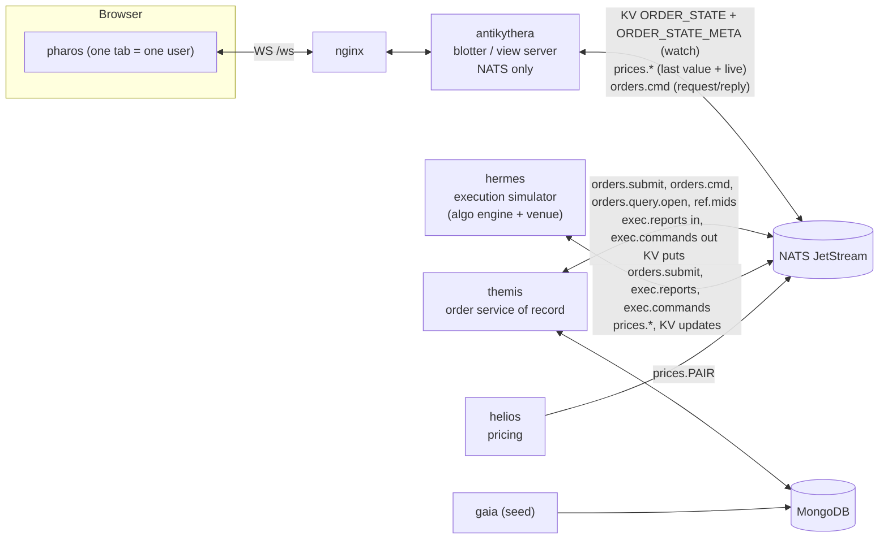

# PLAN1: Architecture split (view server, order service, separate pricing)

Status: **in progress** (agreed 2026-10-11): phases 1.1, 1.2 and 1.3a merged, 1.3b (readiness, warm-up and drain) in review. It builds on `docs/PLAN.md`, phases 1–9, which are
merged. The working process (Sonnet implements one phase per branch and opens a PR; Opus reviews at checkpoints), the
rules for the implementing agent and the coding conventions in `PLAN.md` apply unchanged. **The appendices here are
authoritative for the new contracts.** Where they change a `PLAN.md` appendix (C: protocol, A: config), update that
appendix in the same PR. [`PLAN2-java-blotter.md`](PLAN2-java-blotter.md) and
[`PLAN2.5-comparison-dashboards.md`](PLAN2.5-comparison-dashboards.md) follow this plan.

**Open question for the user:** run `PLAN.md` phase 10 (demo pack) before PLAN1, or after CP-8, so the demo shows
the split architecture?

## Context

Today `antikythera`, the server the UI connects to, is both the view server and, in effect, the system of record:

- it loads every order from Mongo at startup;
- it is the **only process that writes live order changes** to Mongo (write-behind; it acks NATS only after persisting);
- it computes the price-derived fields, and they get persisted whenever a lifecycle change saves the order;
- it stamps `lastUpdateTime` from its own clock on every price tick;
- it pre-checks commands against the lifecycle rules.

`hermes` simulates the market and also applies the lifecycle rules to its own output, so nothing validates fills.

**Goal.** The UI-facing server connects only to the middleware and does only UI work: snapshot, merging the order and
price streams, sort, filter, group, aggregate, entitlements and deltas. A new **order service of record** on the other
side of the middleware owns the database, order ids and every rule about how orders may change: submissions, executions,
cancel/pause/resume, and amends. **Pricing is separate** from the order service; the two streams are independent, and
merging them is the blotter's job.

This split is also what makes PLAN2 practical. Once the blotter is stateless and holds no database, lifecycle or
persistence code, a second implementation (Java) can run beside it with nothing to coordinate.

## Target architecture



| Codename | Role | Connects to | Must not |
|---|---|---|---|
| **pharos** | UI | the blotter over `/ws` | (unchanged) |
| **antikythera** | **Blotter (view server)**: snapshot and live state from NATS, merges prices into open orders, sort, filter, group, aggregate, entitlements, per-client deltas, readiness and warm-up | NATS only | depend on `mnemosyne`/`mongodb`, or apply lifecycle rules |
| **themis** *(new)* | **Order service of record**: Mongo read/write, order ids, validation and lifecycle for submissions, executions, commands and amends; publishes the latest state of every order | Mongo, NATS | subscribe to `prices.*` |
| **helios** *(new)* | **Pricing**: the 20-pair price feed (moved out of hermes) | NATS | know about orders (beyond the one-off `ref.mids` fallback) |
| **hermes** | **Execution simulator**: submits new orders, sends executions (fills, activations, completions), carries out cancel/pause/resume at the "venue", runs the load presets, reconciles stale orders at startup | NATS | touch Mongo, or decide order state |
| **gaia** | Seeder (database side) | Mongo | |

A test in each app enforces its "must not" column. It reads the app's `package.json` and source imports, for example:
antikythera has no `mongodb` or `@apeiron/mnemosyne`; hermes has neither; themis never subscribes to `prices.`.

## Decisions (agreed with user, 2026-10-11)

| Area | Decision |
|---|---|
| Blotter data access | **NATS only.** No database driver in the blotter. |
| Snapshot | **Only the latest state per order.** themis keeps a **JetStream KV bucket `ORDER_STATE`** (history 1, key = `orderId`). A blotter watches it: it gets the initial values (the snapshot), then every change. **A blotter compares the per-order version `v`, never the KV revision**, so republishing the same record is a no-op. |
| Projection marker | themis writes `ORDER_STATE_META` key `projection` = `{ready, count, epoch, builtAt}` once the bucket is complete. A blotter will not load until `ready` is true, and it fails its load if it receives fewer than `count` records. This guards against an empty or half-built bucket (a nats.js v3 KV watch yields nothing for an empty bucket and has no "initial values done" callback). |
| Readiness | A blotter is **not ready until** it has loaded the full snapshot, caught up, has a price for every pair (or `PRICE_WAIT_MS` has passed), and has finished its **warm-up**. It has separate `/health/live` and `/health/ready` endpoints, and the compose healthcheck uses `ready`. On SIGTERM it **drains**: not ready, then close code 1012 so clients reconnect at once. This keeps a seamless release or switch-over possible later. |
| Pricing | **Independent of the order service.** helios publishes `prices.*`. The blotter overlays the price-derived fields on open orders. themis never reads prices; the market snapshot it stores comes from the venue's execution reports. |
| Executions | hermes numbers each order's executions with a monotonic `execSeq`. themis accepts a report only if its `execSeq` is greater than the last one it accepted (duplicates are ignored, gaps allowed). **Fills larger than the remaining quantity are clamped**, as `applyFill` does today, not rejected. |
| Users and entitlements | **Very simple.** A user picker per tab (`sessionStorage`, overridable with `?user=`). Users `TRADER1`…`TRADER5` map to traders `T1`…`T5`, and `SUPERVISOR` sees everyone. Entitlements live in a static JSON file mounted into the blotter. No passwords. |
| Amend | A simple **Amend** action: `limitPrice`, `orderQty`, `endTime`, `urgency` (rules in Appendix 1C). |
| Commands | The blotter checks entitlement and sends a **request/reply** to themis. themis validates against the lifecycle, instructs hermes (the venue), applies the venue's report, publishes, then replies with the new `v`. The blotter acks the client once its store holds that `v`. The blotter no longer pre-checks the lifecycle. |
| Persistence ordering | themis writes to Mongo **before** it publishes to KV, in **group commits** (a window of at most `GROUP_COMMIT_MS` = 20 ms or `GROUP_COMMIT_MAX` = 500 changes). **KV puts are issued in commit order**, so new order ids arrive in ascending order. |
| Resetting data | A reset is always: stop the stack, purge the KV buckets and JetStream streams, seed, start themis (which rebuilds the projection), then everything else. themis never purges the bucket while blotters run. |

## Field ownership: the order record and the price overlay

The 50 columns stay exactly as they are. What changes is who owns each value.

| Fields | Owner | Notes |
|---|---|---|
| `marketBid`, `marketAsk`, `marketMid`, `spreadBps`, `distanceToLimitBps`, `unrealisedPnlUsd` | **The blotter's price overlay**, for `LIVE` and `PAUSED` orders | `deriveOverlay(record, latestTick[pair])`: a **pure** function of the record and the latest quote. It is today's `derivePriceFields` without the `lastUpdateTime` line. |
| The same six fields for every other status | **themis (the record)**: the market snapshot from the last execution report that carried a quote | Terminal and `PENDING_START` orders show frozen values, as they do today. |
| All other 44 fields, including `lastUpdateTime`, `slippageBps` and `realisedPnlUsd` | **themis** | `realisedPnlUsd` at completion = `pnlUsdOf(order, mid)`, where `mid` comes from the bid/ask in the completing report. |

Effects:

- **Price ticks no longer change `lastUpdateTime`.** Users will see that column stop ticking on price moves. The
  resilience S7 relaxation (`lastUpdateTime` may step back across a restart) is removed in 1.4.
- **Deterministic merge.** Two blotters that have applied the same `v` of a record and the same tick show identical
  values. PLAN2's "Node and Java tabs stay in sync" depends on exactly this.

## Build phases and done criteria

Every phase keeps `main` working: `pnpm lint && pnpm typecheck && pnpm test`, the compose stack starts, and `pnpm e2e`
passes before merge. Check library APIs with context7 before use, especially nats.js v3 KV (`watch`, `isUpdate`,
`delta`, `status().values`), request/reply, and ordered consumers. Each phase updates the docs it touches.

| # | Phase (PR) | Scope | Done when |
|---|---|---|---|
| 1.1 | **Contracts and bus primitives** (no runtime change) | `logos`: the types and zod schemas in Appendices 1B and 1G; `OVERLAY_FIELDS` and `deriveOverlay`; pure rule functions `applyExecReport`, `applyAmend`, `validateSubmission`, extracted from `hermes/simulator` and `lifecycle`, each with tests. `Bus` port additions: `request(subject, payload, timeoutMs)`, `serve(subject, handler)`, `kv(bucket)` → `{ensure(config), put, get, status, watch({updatesOnly?})}` with entries carrying `isUpdate` and `delta`, and `lastPerSubject(stream, filter)`. Implemented in `iris` (NATS) and `MemoryBus` (same semantics, including `delta`). Protocol additions from Appendix 1G with `hello.userId` **optional**. `mnemosyne` changes from Appendix 1E (fields `_v`/`_execSeq`, new methods, index) with the contract suite; gaia writes `v = 1` and `execSeq = numFills` | Unit tests cover every rule and schema. `iris` real-server tests (skipped without `NATS_URL`, run in CI's e2e job) watch a 100k-key bucket: they count the initial values exactly using `delta === 0`, then receive live updates. The contract suite passes for Mongo and in-memory |
| 1.2 | **themis, persistence and projection mode** | New app `apps/themis` (Appendices 1E, 1H, 1I): consumes today's `orders.events` through its own durable consumer `themis`, applies them to the full order (open orders in memory, a KV `get` otherwise), group-commits to Mongo, then puts records into `ORDER_STATE`; projection rebuild and the `projection` marker; startup reconciliation. **Persistence moves here**: antikythera's write-behind and `WRITE_BEHIND_MS` are removed, and its consumer acks after applying. **hermes, in the same PR**: terminal updates (fill to completion, cancel) carry the market snapshot (the six overlay fields from its feed's current quote), and realised P&L on cancel uses `pnlUsdOf(order, feedMid)` instead of its stale `unrealisedPnlUsd`. Without this, the record would lose what write-behind used to save. Compose service, images workflow, Terraform service list, Prometheus job. `scripts/loadtest-reset.sh` follows the reset rule in Decisions | e2e passes. After seeding, the KV value count equals the database count and the marker reports `ready`. Killing themis mid-stream loses no writes (its durable consumer replays). A completed order's market fields equal hermes's quote at completion (unit test) |
| 1.3a | **Blotter from NATS only** | antikythera: snapshot and live updates from `ORDER_STATE` exactly as in Appendix 1F, steps 1–5 and the update rules; removes `mnemosyne`/`mongodb`, the loader, the durable consumer, `MONGO_*`, `DB_ADAPTER` and `LOAD_BATCH_SIZE`; adds `store.sortByOrderId()` and a per-row `v` array; prices via `lastPerSubject(PRICES)` then a live subscription. `/health` keeps today's body plus `stage`. e2e `server-probe` uses the idle test in Appendix 1I | All e2e tests and the resilience quick tier pass. **Cold start to loaded ≤ 30 s at 1M rows.** talos (50 clients × 300 s) stays within 20% of every CP-4 figure. The dependency test proves there is no database driver. A blotter started against an empty, unmarked bucket stays in `snapshot` and never reports `ok` (test) |
| 1.3b | **Readiness, warm-up and drain** | Appendix 1F, steps 6–8: `/health/live`, `/health/ready`, stages, `WARM_VIEWS` and `WARM_ROUNDS`, drain with code 1012; pharos reconnects at once on 1012 and keeps its user, trader, codec and server choices; compose healthcheck switches to `/health/ready` | Warm-up ≤ 5 s; no client is served `rows` before ready (test); during a `docker compose restart antikythera`, pharos reconnects without backing off; the resilience quick tier passes |
| 🔍 | **OPUS REVIEW CP-7: Snapshot and readiness** | | Watch-ordering correctness (no lost or regressed update between the initial values and live updates); the marker and count guard; `v`-based staleness; memory peak while loading; the ready gate cannot pass early; drain behaviour. If loading misses the 30 s target by more than 2×, stop and choose a fallback from Appendix 1J |
| 1.4 | **Pricing split** | New app `apps/helios`: the price feed moves out of hermes unchanged; `PRICES` moves to **file** storage; start levels come from the last value per pair, else a `ref.mids` request to themis (retried for 10 s), else `PAIRS.mid`. Overlay semantics in the blotter: open orders only, and `lastUpdateTime` no longer touched. hermes subscribes to `prices.*` and keeps the latest quote per pair for fill prices and market snapshots. The resilience driver gains `stopHeliosContainer`/`startHeliosContainer` | With helios stopped, orders keep updating and prices freeze. With hermes stopped, prices keep ticking. The S7 `lastUpdateTime` relaxation is removed and S7 passes |
| 1.5a | **Execution path in themis, behind a switch** | themis: `orders.submit` (assigns ascending ids), the `EXEC` stream with its durable consumer `themis-exec`, and the Appendix 1C rules (clamping, `execSeq`); `orders.query.open`; `ref.mids` moves to the new repository method. hermes: an `EXEC_MODE=events\|reports` switch (default `events`). In `reports` mode it sends submissions and execution reports instead of `orders.events`, tracks `execSeq` per order, and starts up as Appendix 1K describes. Both modes run in CI's unit tests | Unit tests for every rule (a duplicate `execSeq` is ignored; an over-fill is clamped; a fill on a `PAUSED` order is rejected). In `reports` mode the stack passes e2e locally. Medium and stress rates hold, with themis group-commit p95 ≤ 100 ms |
| 1.5b | **Switch to execution reports** | `EXEC_MODE=reports` becomes the only mode; `orders.events`, the `ORDERS` stream and hermes's Mongo access (`MONGO_*`) are removed. The resilience driver's independent model is fed from `ORDER_STATE` updates (the record stream) plus the ticks, instead of `orders.events`, and its tee implements the new `Bus` methods | The hermes container has no `MONGO_*` env and its dependency test passes; e2e and the resilience quick tier pass |
| 1.5c | **Commands through themis** | Blotter: entitlement check (all traders allowed until 1.6), then an `orders.cmd` request; acks the client once its store holds `v ≥ reply.v` for that order (waits at most `ACK_WAIT_V_MS` = 2 s, then acks anyway). The event-matching `CommandCorrelator` is removed. themis: validation, then a `VenueInstruction` on `exec.commands` (the `VENUE` stream, hermes's durable consumer `hermes-venue`), waits for the venue's report (`VENUE_TIMEOUT_MS` = 5 s), applies it, then replies. Error mapping as in Appendix 1G | Cancel, Pause and Resume e2e tests pass; command ack p95 ≤ 150 ms on medium; invalid actions show the toast as today; a venue timeout reaches the client as `INTERNAL` (test) |
| 1.6 | **Users and entitlements** | Appendix 1D: `infra/config/entitlements.json`; `hello.userId` becomes **required**; `welcome.user`; `traders` limited to the user's entitlements; scoped queries; `FORBIDDEN` and `UNKNOWN_USER`. pharos: a user picker per tab (a modal on first load, then a header select) plus `?user=`, stored in `sessionStorage`; the trader selector shows only entitled traders. talos and the existing e2e tests use `SUPERVISOR` | A new e2e test opens two browser contexts (`TRADER1`, `TRADER2`): each sees only its own orders, a command forged across users gets `FORBIDDEN`, and `SUPERVISOR` sees all |
| 1.7 | **Amend** | Protocol `amend`; themis rules (Appendix 1C); pharos: an "Amend…" context-menu item (enabled for `PENDING_START`, `LIVE` and `PAUSED`) opening a small dialog (limit price, quantity, end time, urgency) whose client-side checks mirror the server's (for user experience only), with ack/error toasts | Unit tests per rule; an e2e test amends quantity and limit and sees them in **two tabs** (`TRADER1` and `SUPERVISOR`); an invalid amend shows the `INVALID_AMEND` toast |
| 1.8 | **Verification and docs** | New resilience scenarios: **S10** themis restarts mid-stream (model check: no lost or duplicated fills); **S11** helios outage (orders still flow, prices resume); **S12** blotter restart (no client is served before ready; reconnect after drain). Grafana: a themis row on the existing dashboard. Full talos run against CP-4. Update `architecture.md`, `README.md`, `TESTING.md`, `db-adapters.md` and the plan status | The full resilience suite passes, each new scenario 3×; talos within 20% of CP-4 except command ack (≤ 150 ms p95); docs updated |
| 🔍 | **OPUS REVIEW CP-8: Split complete** | | Boundary rules hold (dependency tests); themis rule coverage; persist-then-publish recovery (Appendix 1E); entitlement leaks (any query or delta reaching a user outside their scope); load and latency results |

## Appendix 1A: Subjects, streams and buckets

| Subject / bucket | Config | Producer → consumer | Payload |
|---|---|---|---|
| `prices.<PAIR>` | `PRICES`: **file**, limits, `max_msgs_per_subject` 1 | helios → blotters, hermes | `PriceTick` (unchanged) |
| KV `ORDER_STATE`, key `<orderId>` | file, history 1, replicas 1, `max_value_size` 16 KiB, `max_bytes` 4 GiB, no TTL | themis → blotters (watch), hermes (updates only) | `OrderStateRecord`, JSON UTF-8 |
| KV `ORDER_STATE_META`, key `projection` | file, history 1 | themis → blotters | `ProjectionMarker` |
| `orders.submit` | request/reply | hermes → themis | `Submission` → `SubmitReply` |
| `orders.cmd` | request/reply | blotter → themis | `OrderCommandRequest` → `OrderCommandReply` |
| `orders.query.open` | request/reply; the reply is chunked (`{chunk, of, records}`, ≤ 500 records per message) | hermes → themis | open orders as `OrderStateRecord[]` |
| `ref.mids` | request/reply | helios → themis (startup fallback only) | `Record<CurrencyPair, number>` |
| `exec.reports` | `EXEC`: file, limits, 24 h; durable `themis-exec`, AckPolicy.All | hermes → themis | `ExecReport` |
| `exec.commands` | `VENUE`: file, limits, 24 h; durable `hermes-venue`, AckPolicy.All | themis → hermes | `VenueInstruction` |
| `control.load`, `control.state` | core | unchanged (hermes) | unchanged |
| **Retired in 1.5b** | | | `orders.events`, `orders.commands`, the `ORDERS` stream, the `blotter-server` and `themis` durables |

Ownership: themis creates `ORDER_STATE`, `ORDER_STATE_META`, `EXEC` and `VENUE`; helios creates `PRICES`; hermes
creates nothing. The `iris` `ensureStreams` pattern is reused per owner. Keys must match `^[A-Za-z0-9_-]+$`; themis
rejects any other `orderId`.

A blotter uses only **ephemeral** watches and ordered consumers, never a durable consumer. Any number of blotters, in
any language, can run side by side without coordinating.

## Appendix 1B: Record and message types (logos)

```ts
/** KV value in ORDER_STATE. `v`: per-order version, 1 at creation, +1 per accepted change. `execSeq`: last accepted execution. */
type OrderStateRecord = { v: number; execSeq: number; srcTs: number; order: Order };

type ProjectionMarker = { ready: boolean; count: number; epoch: string; builtAt: number };

type Quote = { bid: number; ask: number };

type ExecReport =
  | { type: 'ACTIVATED'; orderId: string; execSeq: number; ts: number }
  | ({ type: 'FILL'; orderId: string; execSeq: number; qty: number; price: number; ts: number } & Quote)
  | ({ type: 'CANCELLED'; orderId: string; execSeq: number; instrId?: string; reason: 'TRADER' | 'EXPIRED'; ts: number } & Quote)
  | { type: 'PAUSED' | 'RESUMED'; orderId: string; execSeq: number; instrId: string; ts: number }
  | { type: 'VENUE_REJECT'; orderId: string; execSeq: number; instrId: string; message: string; ts: number };

type VenueInstruction = { instrId: string; orderId: string; action: CommandAction; ts: number };   // instrId = commandId

type OrderCommandRequest = {
  commandId: string;            // "<clientId>:<reqId>"
  userId: string;
  orderId: string;
} & ({ kind: 'action'; action: CommandAction } | { kind: 'amend'; changes: AmendChanges });

type CommandRejectCode = 'INVALID_TRANSITION' | 'UNKNOWN_ORDER' | 'INVALID_AMEND' | 'VENUE_REJECT' | 'TIMEOUT';
type OrderCommandReply = { ok: true; v: number } | { ok: false; code: CommandRejectCode; message: string };

type AmendChanges = Partial<Pick<Order, 'limitPrice' | 'orderQty' | 'endTime' | 'urgency'>>;

type Submission = { clientOrderId: string; order: Omit<Order, 'orderId'> };   // idempotent on clientOrderId
type SubmitReply = { ok: true; orderId: string; v: number } | { ok: false; code: 'INVALID_SUBMISSION'; message: string };
```

- `srcTs` is the source timestamp: the report's or instruction's `ts`. It feeds `delta.srcTs`, so end-to-end
  tick-to-screen is still measured from the origin.
- A completion by `endTime` is either a `FILL` of the remaining quantity or a `CANCELLED` with `reason: 'EXPIRED'`,
  matching today's 92/8 split.
- hermes assigns `execSeq` per order: the record's `execSeq + 1` and up, kept in its own state, so concurrent reports
  for one order never collide.

## Appendix 1C: themis rules

Every accepted change:
1. `v + 1`, and `lastUpdateTime = ts`;
2. the change joins the next group commit to Mongo (with `_v` and `_execSeq`);
3. the KV put follows, in commit order;
4. then the reply is sent, or the input is acked.

Rejections change nothing, and execution-report rejections are logged and counted.

| Input | Accepted when | Effect |
|---|---|---|
| `Submission` | schema-valid; status `LIVE` or `PENDING_START`; `orderQty > 0`; trader and account known; `clientOrderId` not seen in the last 24 h (in-memory map, rebuilt from open orders at startup) | Next `ALG` sequence id (ascending, from `maxOrderId()` at startup); `createdAt = ts`; `v = 1`, `execSeq = 0` |
| Any `ExecReport` | `execSeq > record.execSeq`, otherwise ignored as a duplicate (acked, counted) | `record.execSeq = report.execSeq` (also set when the report is rejected below, so a bad report is not replayed forever) |
| `ACTIVATED` | status `PENDING_START` | → `LIVE` |
| `FILL` | status `LIVE`; `price > 0`; `qty > 0` | `qty` clamped to `remainingQty` (a clamp is counted; if nothing remains, it is ignored); `applyFill`; market snapshot from the quote; on the last fill → `FILLED`, realised P&L at the quote's mid |
| `CANCELLED` | status `PENDING_START`, `LIVE` or `PAUSED` | → `CANCELLED`; market snapshot; realised P&L at the quote's mid; `unrealisedPnlUsd = 0` |
| `PAUSED` / `RESUMED` | `canTransition` from the current status | Status change; on `RESUMED`, `endTime` is extended by the time spent paused (now − `lastUpdateTime`), as today |
| `VENUE_REJECT` | a pending instruction with that `instrId` | No order change; the waiting command is answered `VENUE_REJECT` |
| Command `CANCEL` / `PAUSE` / `RESUME` | the order exists (in memory, or a KV `get`); `canApplyCommand(status, action)`; no other instruction pending for that order | Sends a `VenueInstruction` and waits for the venue's report (≤ `VENUE_TIMEOUT_MS`, then `TIMEOUT`). Replies after that report is applied |
| Amend | status `PENDING_START`, `LIVE` or `PAUSED`; only the four fields; `orderQty` an integer `> filledQty`; `limitPrice` null or `> 0` with no more than the pair's decimals; `endTime > max(now, startTime)`; `urgency` in the enum; at least one field actually changes | `remainingQty`, `pctComplete`, `notionalUsd` (same USD rate per unit) and `durationMins` recomputed. Applied directly; hermes picks up the new parameters from the KV update |

## Appendix 1D: Users and entitlements

```json
{ "users": [
  { "userId": "TRADER1", "name": "Alice Marlowe", "traders": ["T1"] },
  { "userId": "TRADER2", "name": "Ben Okafor",    "traders": ["T2"] },
  { "userId": "TRADER3", "name": "Chloe Tanaka",  "traders": ["T3"] },
  { "userId": "TRADER4", "name": "Diego Ramirez", "traders": ["T4"] },
  { "userId": "TRADER5", "name": "Elena Voss",    "traders": ["T5"] },
  { "userId": "SUPERVISOR", "name": "Desk Supervisor", "traders": ["*"] }
] }
```

- The file is `infra/config/entitlements.json`, mounted read-only into every blotter at `/config/entitlements.json`
  (`ENTITLEMENTS_FILE`), and validated at startup against `entitlementsSchema` in logos. A plain file is deliberate:
  the Node and Java blotters read the same source.
- `hello { userId, traderId }`: `traderId` must be one of the user's traders, or `ALL`, meaning all of them.
  `welcome.user = {userId, name}`; `welcome.traders` lists only the entitled traders.
- The view key includes the resolved trader set, so users with different scopes never share a view.
- Summaries and filter values are scoped the same way.
- Commands and amends on an order outside the user's traders get `FORBIDDEN` before anything reaches themis.
  `requestedBy = userId`. themis trusts the blotter (an internal hop) and logs `userId`.

## Appendix 1E: themis persistence, recovery and the repository

**`mnemosyne` changes (phase 1.1):**
- Stored documents gain `_v` and `_execSeq` beside the 50 fields. The `Order` type is unchanged; new type
  `StoredOrder = { order: Order; v: number; execSeq: number }`. Documents without those fields read as `v = 1` and
  `execSeq = numFills`.
- `OrderRepository`:
  - `loadAll(batchSize?)` and `upsertMany(records)` work on `StoredOrder`;
  - `loadCurrent()` is renamed `loadOpen(): Promise<StoredOrder[]>`;
  - new: `loadUpdatedSince(ts): AsyncIterable<StoredOrder[]>` and `latestMidsByPair(): Promise<Record<CurrencyPair, number>>`
    (the latest `marketMid` per pair among open orders; today's hermes start-level logic);
  - unchanged: `count`, `isSeeded`, `maxOrderId`, `clear`.
- New index `{lastUpdateTime: -1}`. The contract suite and the in-memory adapter are updated, and so is `db-adapters.md`.

**Runtime:**
- **In memory:** open orders (`PENDING_START`, `LIVE`, `PAUSED`) as `StoredOrder`, the id sequence, the
  `clientOrderId` map, and pending venue instructions.
- **Orders not in memory:** checked with a KV `get` (terminal → `INVALID_TRANSITION`; missing → `UNKNOWN_ORDER`).
- **Order of writes:** the Mongo group commit (`bulkWrite`, unordered within a batch, batches strictly in sequence) is
  awaited, then the KV puts for that batch are issued in order on one connection, and their acks are awaited. A failed
  KV put is retried with backoff until it succeeds, and replies and acks wait for it.
- **Crash between the Mongo write and the KV put:** at startup themis compares `_v` against the KV record's `v` for
  open orders and for orders from `loadUpdatedSince(now − RECONCILE_WINDOW_MIN)`, and republishes any that differ.
- **Durable inputs:** `exec.reports` is acked after the change is persisted and published. Replays are caught by the
  `execSeq` rule.
- **Projection rebuild:** runs when `ORDER_STATE_META.projection` is missing or not ready, when the bucket's
  `status().values` differs from `count()`, or when `REBUILD_PROJECTION=1`. Steps:
  1. write the marker as `ready: false`;
  2. stream `loadAll` into KV with batched async puts (expect about 30–60 s at 1M rows);
  3. write the marker as `{ready: true, count, epoch: <uuid>, builtAt}`.

  `/health` reports 503 until the rebuild finishes. The rebuild never deletes keys.

## Appendix 1F: Blotter snapshot, updates, readiness, warm-up and drain

1. **Wait for the projection.** `stage = snapshot`. Watch `ORDER_STATE_META` until `projection.ready` is true, and
   note `expected = projection.count`.
2. **Load the initial values.** Open a watch on `ORDER_STATE` (all keys, last values). For each `PUT` entry with
   `isUpdate === false`, decode the record **straight into the columnar store** (append; store `v` per row). No
   `Order` objects are retained, which keeps the load peak close to today's. The initial phase ends at the entry with
   `delta === 0`. If the bucket's `status().values` is 0, the load fails, because the marker said it was ready.
3. **Check the count.** If fewer than `expected` records were loaded, log an error, discard the store and retry from
   step 1 after 5 s.
4. **Order the store.** Call `store.sortByOrderId()`: one permutation of every column and the `v` array, plus a
   rebuild of the orderId→row map. Then build the string ranks, status counters and `liveByPair`.
5. **Catch up.** `stage = catchup`. Entries with `isUpdate === true` go through the normal flush path. Caught up when
   the latest entry's `delta ≤ CATCHUP_MAX_PENDING` (100).
6. **Prices.** `stage = prices`. `lastPerSubject(PRICES, 'prices.*')` provides the latest tick per pair, then a live
   subscription. Wait up to `PRICE_WAIT_MS` for every pair, then continue and log the missing pairs.
7. **Warm-up.** `stage = warmup`. `WARM_VIEWS=default` builds:
   - the `createdAt desc` view for every distinct trader set in the entitlements file;
   - `ALL` grouped by `status`.

   A path value instead points to a JSON file of `{traders: string[] | '*', req: SsrmRequest}` entries. Then run
   `WARM_ROUNDS` synthetic passes of `getRows` (blocks 0–4) over each view, and record `warmupMs`.
8. **Ready.** `stage = ready`. Drain on SIGTERM: `stage = draining`, `/health/ready` returns 503, new upgrades are
   refused, every socket is closed with **code 1012** after `DRAIN_MS` (2 s), then the process exits.

**Update rules (live, and during catch-up):**
- `DEL`/`PURGE` entries are ignored and counted (`apeiron_records_ignored_total{reason="delete"}`).
- No row for the `orderId` → append (a new order: it feeds `adds` and the badge exactly as `NEW` events do today).
- `record.v ≤ v[row]` → ignored (`reason="stale"`). A projection rebuild is therefore a no-op for running blotters.
- Otherwise `store.updateRow(row, record.order)` (it returns the changed fields), then `v[row] = record.v`, then the
  overlay is recomputed for open orders with the latest tick.

**Endpoints:**
- `/health/live`: 200 once the process is up.
- `/health/ready`: 200 only at `ready`, otherwise 503.
- `/health`: an alias of `ready`; today's body plus `stage`, `snapshotMs` and `warmupMs`.

**Why warm up:** so that "ready" means fast, not just loaded. It matters more for the JVM (JIT), but both
implementations do it.

## Appendix 1G: Protocol changes (update `PLAN.md` Appendix C and `logos/protocol.ts`)

```ts
// ClientMsg
| { t: 'hello'; userId: string; traderId: string; codec: CodecName; clientId: string }   // userId optional in 1.1-1.5, required from 1.6
| { t: 'amend'; reqId: number; orderId: string; changes: AmendChanges }                  // new in 1.7

// ServerMsg 'welcome' gains
user?: { userId: string; name: string };                                     // set from 1.6
server?: { impl: 'node' | 'java'; version: string; startedAt: number };      // added in PLAN2 2.7; Node sends it too

// ERROR_CODES gains
'FORBIDDEN' | 'UNKNOWN_USER' | 'INVALID_AMEND'
```

- **Command and amend error mapping (blotter):** themis `INVALID_TRANSITION`, `UNKNOWN_ORDER` and `INVALID_AMEND`
  pass through unchanged. `VENUE_REJECT` → `INVALID_TRANSITION`, carrying the venue's message. `TIMEOUT`, or no reply
  within `COMMAND_TIMEOUT_MS`, → `INTERNAL`.
- **WebSocket close codes:** 1012 means "server restarting": pharos reconnects at once (no backoff) and keeps its
  user, trader, codec and server choices. Every other code keeps today's behaviour.
- **talos and the e2e protocol clients** send `userId: 'SUPERVISOR'`.

## Appendix 1H: Config, ports and compose (update `PLAN.md` Appendix A and `.env.example`)

| Service | Port (host, all `127.0.0.1`) | Env added | Env removed |
|---|---|---|---|
| antikythera | 4000 | `ENTITLEMENTS_FILE` (`/config/entitlements.json`), `PRICE_WAIT_MS` (10000), `CATCHUP_MAX_PENDING` (100), `WARM_VIEWS` (`default`), `WARM_ROUNDS` (3), `DRAIN_MS` (2000), `COMMAND_TIMEOUT_MS` (5000), `ACK_WAIT_V_MS` (2000) | `MONGO_URL`, `MONGO_DB`, `DB_ADAPTER`, `WRITE_BEHIND_MS` (1.2), `LOAD_BATCH_SIZE` (1.3a) |
| themis | 4200 (`/health`, `/metrics`, `/debug`) | `MONGO_URL`, `MONGO_DB`, `NATS_URL`, `HEALTH_PORT` (4200), `GROUP_COMMIT_MS` (20), `GROUP_COMMIT_MAX` (500), `VENUE_TIMEOUT_MS` (5000), `RECONCILE_WINDOW_MIN` (15), `REBUILD_PROJECTION` (0), `LOG_LEVEL` | (new) |
| helios | 4300 (`/health`, `/metrics`) | `NATS_URL`, `HEALTH_PORT` (4300), `HELIOS_SEED`, `LOG_LEVEL` | (new) |
| hermes | 4100 | `EXEC_MODE` (1.5a only) | `MONGO_URL`, `MONGO_DB` (1.5b), `EXEC_MODE` (1.5b) |

**Compose start order (`depends_on`):**
- `mongo` and `nats` (healthy) → `themis` (healthy = the projection is ready; `start_period` 300 s);
- `nats` → `helios`;
- `themis` (healthy) and `helios` → `hermes`;
- `nats` and `themis` (healthy) → `antikythera` (healthcheck `/health/ready`; `start_period` 120 s) → `pharos`.

themis and helios use the shared Node Dockerfile (`APP=themis`, `APP=helios`). Add both to the images workflow
matrix, `infra/aws/variables.tf` and the Prometheus scrape config. **Docker VM: 8 GB** (Appendix 1J).

## Appendix 1I: Observability and the e2e idle test

**New metrics:**

| Process | Metrics |
|---|---|
| themis | `themis_commit_batch_size` (histogram), `themis_commit_duration_seconds`, `themis_kv_put_duration_seconds`, `themis_exec_reports_total{type,result}` (result: `applied`, `duplicate`, `rejected`), `themis_fills_clamped_total`, `themis_commands_total{kind,result}`, `themis_command_duration_seconds`, `themis_submissions_total{result}`, `themis_open_orders` (gauge), `themis_projection_rebuild_seconds`, plus the default process metrics |
| helios | `helios_ticks_total` |
| blotter | `apeiron_startup_seconds{stage}` (`snapshot`, `catchup`, `prices`, `warmup`), `apeiron_records_applied_total`, `apeiron_records_ignored_total{reason}` |

**Debug fields:**
- The blotter's `/debug/lag` gains `stage`, `appliedRev` (the highest KV revision applied), `records` (applied and
  ignored counts) and `lastTickTs` (per pair).
- themis's `/debug` reports `openOrders`, `pendingInstructions`, the last commit batch and its timing.

**e2e idle test** (replaces the `blotter-server` consumer check in `server-probe.ts`). The system is idle when two
consecutive snapshots both show:
- the blotter at `ready`;
- `appliedRev` equal to the `KV_ORDER_STATE` stream's `last_seq` (from NATS `/jsz?streams=true&consumers=true`);
- the `themis-exec` consumer with `num_pending` and `num_ack_pending` both 0;
- no change in `appliedRev` between the two snapshots.

## Appendix 1J: Risks, sanctioned fallbacks and memory budget

| Risk | Signal | Fallback |
|---|---|---|
| A KV watch over 1M keys is too slow (JSON decode, flow control) | Loading takes > 60 s | msgpack-encoded KV values; or a chunked snapshot by request/reply (`orders.snapshot`, "as of revision N", then a watch from N+1 using `resumeFromRevision`) |
| NATS memory for 1M subjects | NATS RSS > 1 GB | Accept it, and record it in the budget below |
| Extra hops on commands | Ack p95 > 150 ms | Venue reports for commands over core request/reply, keeping the `VENUE` stream for recovery only |
| Group commit adds latency to order updates | Tick-to-screen p95 > 150 ms | `GROUP_COMMIT_MS` = 10 |
| themis is a single instance | | Accepted for the POC; record it in the docs |

**Memory budget (Docker VM).** Mongo 1 GB, NATS about 1 GB (KV with 1M subjects), antikythera about 1 GB, themis
about 0.3 GB, hermes, helios and nginx about 0.3 GB, Prometheus and Grafana about 0.3 GB. **8 GB** for PLAN1, and
**10 GB** once PLAN2's Java blotter runs as well.

## Appendix 1K: hermes startup in `reports` mode

1. Start a KV watch on `ORDER_STATE` with `updatesOnly`, and buffer its entries.
2. Request `orders.query.open` and load the records (orders with their `v` and `execSeq`).
3. Apply the buffered entries whose `v` is higher than the held `v`; later entries are applied as they arrive. A
   record that becomes terminal is dropped from the simulation.
4. Get the latest quote per pair (`lastPerSubject(PRICES)`, then the live subscription).
5. **Reconcile stale orders** (the logic from today's hermes, now sent as reports):
   - `LIVE` past `endTime` → `FILL` of the remainder (92%) or `CANCELLED` `EXPIRED` (8%);
   - `PENDING_START` past `startTime` → `ACTIVATED`.
6. Top up `LIVE` to the preset's target with `orders.submit`, then start the simulator loop. Fills are paced per
   order as today (Appendix E, "Pacing as built").
7. **Venue instructions** (`hermes-venue` consumer): apply to the simulated order and answer with a
   `PAUSED`/`RESUMED`/`CANCELLED` report, or a `VENUE_REJECT` if the order has already completed. Ack the
   instruction after the report is published.
