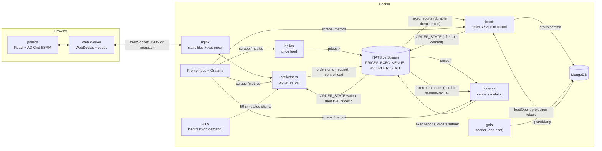
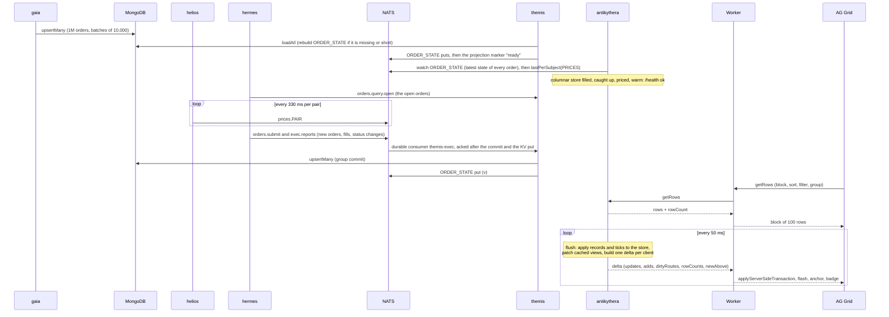
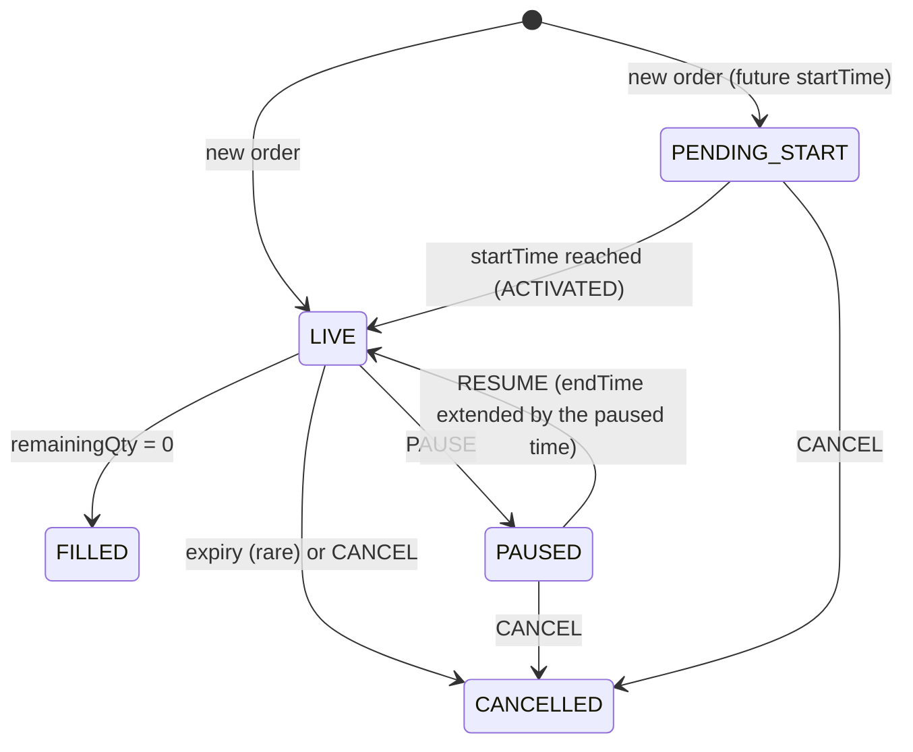
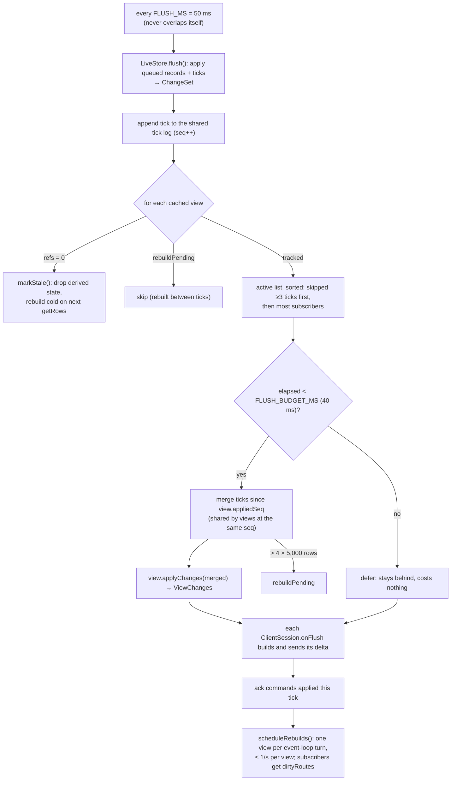
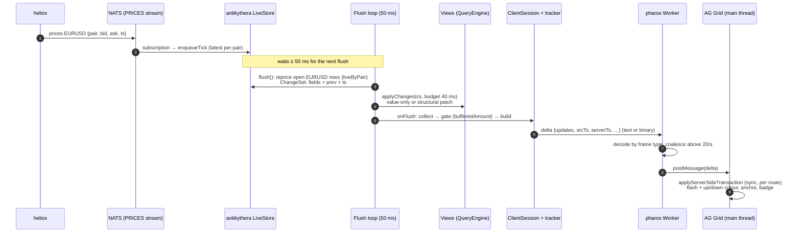
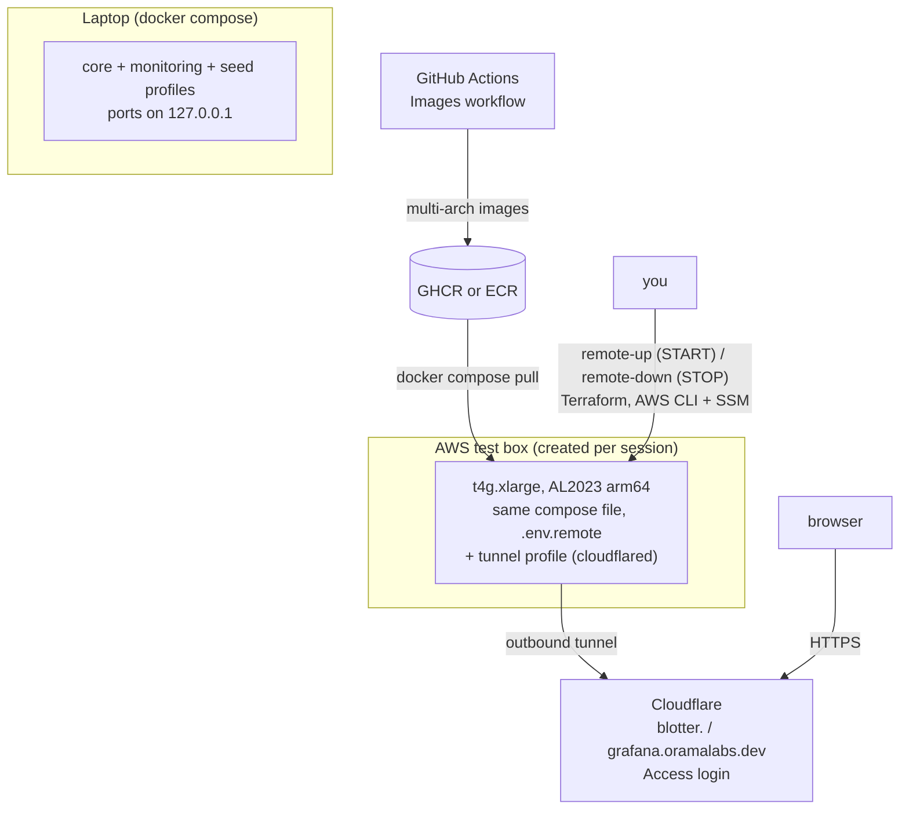

# Architecture

Apeiron shows 1M+ FX algo orders × 50 columns in a browser grid, ticking live, with the server doing the sorting,
filtering, grouping and aggregation for every connected blotter. This page is how it works today: the components, how
data moves, and the algorithms that make it fast. The record itself is in [data-model.md](data-model.md), the measured
figures in [performance.md](performance.md), and the reasons in [decisions.md](decisions.md). The original contracts are
in the plan appendices ([`plans/PLAN.md`](plans/PLAN.md), [`plans/PLAN1-architecture-split.md`](plans/PLAN1-architecture-split.md));
the code is the final authority.

- [Components](#components)
- [Data flow](#data-flow)
- [The order lifecycle](#the-order-lifecycle)
- [The blotter server (antikythera)](#the-blotter-server-antikythera)
- [The order service (themis)](#the-order-service-themis)
- [Prices and the venue (helios, hermes)](#prices-and-the-venue-helios-hermes)
- [Wire protocol](#wire-protocol)
- [The client (pharos)](#the-client-pharos)
- [Observability](#observability)
- [Deployment view](#deployment-view)

## Components

| Codename | Package | Role |
|---|---|---|
| **pharos** | `apps/pharos` | The web app. React 19, Vite, AG Grid Enterprise 36 with the server-side row model, a Web Worker that owns the socket and the codec, Zustand for small app state. Served by unprivileged nginx, which also proxies `/ws` |
| **antikythera** | `apps/antikythera` | The blotter server (Node, Fastify 5, `ws`). Holds every order in memory, answers `getRows`, follows `ORDER_STATE` and the prices, and pushes deltas. Connects only to NATS: it has no database driver |
| **themis** | `apps/themis` | The order service of record. Owns the database: takes submissions and execution reports, applies them to the full order, stores each batch (group commit), then publishes the order's new version to the `ORDER_STATE` KV bucket and acknowledges the input. Rebuilds the bucket (the "projection") from the database when it is missing or incomplete, and reconciles anything a crash left unpublished. Never reads prices |
| **helios** | `apps/helios` | The price feed: a 20-pair random walk published as `prices.<PAIR>` at 3 ticks per second each, to the `PRICES` stream (one message kept per subject). Starts each walk from the last price on the stream, else from the order service's `ref.mids`, else the pair's reference level. Knows nothing about orders |
| **hermes** | `apps/hermes` | The venue simulator: the order lifecycle (pending to live, fills, new orders) and carrying out venue instructions. Follows `prices.*` for fill prices; makes no prices and has no database. Stands in for the real order management system |
| **gaia** | `apps/gaia` | The seeder: deterministic generation of 1M orders over six months, bulk-loaded into the database; a second run is a no-op |
| **talos** | `apps/talos` | The load harness: N WebSocket clients, each with its own sort, filter, group and scroll pattern (method in [performance.md](performance.md#method)) |
| **logos** | `packages/logos` | The shared vocabulary: the `Order` type, the 50-column metadata, the protocol, the JSON and msgpack codecs, the PRNG and generator, the `Bus` port, the lifecycle state machine and the order rules (`applyExecReport`, `applyAmend`) |
| **mnemosyne** | `packages/mnemosyne` | The `OrderRepository` port and its adapters (Mongo, in-memory), plus the contract suite; see [db-adapters.md](db-adapters.md) |
| **iris** | `packages/iris` | The NATS adapter for the `Bus` port: JetStream stream and consumer definitions |
| **e2e** | `e2e/` | Playwright end-to-end tests and the resilience suite ([testing.md](testing.md)) |

Two ports keep the infrastructure replaceable: `OrderRepository` (storage) and `Bus` (messaging). The engine, protocol
and UI depend on neither NATS nor Mongo, and only `themis` and `gaia` touch the database.

## Data flow

1. **Seed.** `gaia` generates orders deterministically (same `SEED`, same orders) and writes them in batches.
2. **Projection.** At startup `themis` checks the `ORDER_STATE` bucket against the database (the marker in
   `ORDER_STATE_META` and the counts); if it is missing or short it streams every order into it and marks it ready.
3. **Load.** `antikythera` waits for the marker, reads the bucket's initial values straight into the columnar store, sorts
   the rows by `orderId`, catches up on the changes made meanwhile, takes the last price of every pair and warms up the
   default views. `/health` is 503 with its `stage` (`snapshot`, `catchup`, `prices`, `warmup`) until it is `ready`.
4. **Live updates.** `helios` publishes price ticks. `hermes` sends new orders as submissions and everything else as
   execution reports; `themis` stores them and publishes each order's new version. `antikythera` applies a record only
   if its `v` is above the row's. A restart replays nothing: it loads the latest state of every order again.
5. **Deltas.** Every flush the server patches its cached views and each client session turns the changes into a `delta`
   for the rows that client holds.
6. **Grid.** The worker decodes the delta and posts it to the main thread, which applies it synchronously
   (flash, up/down colour), keeps the viewport anchored, and counts new orders for the badge.

**Commands** go the other way: a context-menu action becomes a `command` message; the server validates it (zod) and
sends it to `themis` as a request on `orders.cmd`. `themis` checks it against the lifecycle, instructs the venue
(`exec.commands`) and replies once `hermes`'s execution report is stored and published, with the order's new version.
The status change reaches every client as an ordinary update; the server acknowledges the command once its own store
holds that version ([command correlation](#command-correlation)).

**Amend** follows the same path with `kind: 'amend'`: the context menu's "Amend order…" opens a dialog (limit price,
quantity, end time, urgency) that runs the order service's own `checkAmend` to warn before sending. `themis` applies an
amend directly (no venue instruction) with `applyAmend`: it validates the four fields, recomputes `remainingQty`,
`pctComplete`, `notionalUsd`, `filledNotionalUsd` and `durationMins`, and writes a new version. `hermes` picks the new
parameters up from the `ORDER_STATE` update.

## The order lifecycle

Shared rules in [`packages/logos/src/lifecycle.ts`](../packages/logos/src/lifecycle.ts) and
[`rules.ts`](../packages/logos/src/rules.ts); `themis` enforces them.

## The blotter server (antikythera)

### Columnar store

[`store/columnar-store.ts`](../apps/antikythera/src/store/columnar-store.ts),
[`dictionary.ts`](../apps/antikythera/src/store/dictionary.ts), [`string-rank.ts`](../apps/antikythera/src/store/string-rank.ts).
Orders are never held as objects. Each column is a typed array on a `SharedArrayBuffer` (so a `worker_threads` pool could
read it later without copying):

| Column kind | Storage | Per row |
|---|---|---|
| number, datetime, date (32 columns) | `Float64Array`; null = `NaN`; `-0` stored as `0` | 8 bytes |
| enum (14 columns) | dictionary codes in `Uint8Array` (widens to `Uint16Array` past 256 values) + a per-dictionary rank array | 1 byte |
| free-text strings (orderId, parentOrderId, clientOrderId, strategyParams) | one `string[]` each, plus a lazily built **sort-rank** array per column | heap |
| lookup | `orderId → rowIndex` `Map`, and a per-row version array `v` | |

Capacity is reserved up front (`STORE_CAPACITY`, 1.5M; grows 1.5×) so arrays don't reallocate while serving. Row
objects are built only for the blocks being sent. Enum dictionaries can grow live (a new venue); string ranks are
refreshed in a background task, not on the hot path. Order ids ascend, which gives radix sorts a free tiebreak.

### Loading

[`snapshot.ts`](../apps/antikythera/src/snapshot.ts). The blotter waits for the `ORDER_STATE_META` `projection` marker
to be `ready`, then watches the `ORDER_STATE` bucket and decodes each initial value straight into the store in batches of
2,000. The initial phase ends at the entry with `delta === 0`. A bucket that is empty, or that delivers fewer orders than
the marker counted, makes it clear the store and start again, so a half-built projection never serves a client. The
bucket delivers orders in the order they last changed, so the load ends with `store.sortByOrderId()` (one permutation of
every column and of `v`) and the string ranks. The server listens first, so `/health` answers 503 with the current
`stage` during the load.

**Ready means fast, not just loaded:** before it says so it builds the default views (`createdAt desc` for everyone and
for each trader, everyone grouped by status; `WARM_VIEWS` can point at a JSON file of `{traders, req}` entries) and runs
`WARM_ROUNDS` passes of blocks 0 to 4 over each. Three endpoints: `/health/live` (the process is up), `/health/ready`
(200 only at `ready`; the compose healthcheck) and `/health`, an alias of ready whose body adds `rows`, `snapshotMs`,
`warmupMs`, memory and live figures. On SIGTERM it drains: `/health/ready` turns 503 at once, new WebSocket upgrades are
refused, and after `DRAIN_MS` (2 s) every socket is closed with code **1012** ("server restarting"), which pharos answers
by reconnecting at once (keeping its user, trader and codec) instead of backing off.

### Query engine

[`query/`](../apps/antikythera/src/query): pure functions over the store, property-tested against a naive reference
([`testing/reference.ts`](../apps/antikythera/src/testing/reference.ts)).

- **Request normalisation** ([`request.ts`](../apps/antikythera/src/query/request.ts)): validates the SSRM request,
  rejects pivot, and reduces it to a canonical form plus a **view key** (trader scope, filter, sort, group columns; key
  order, set-value order and condition order don't matter; flat views ignore `valueCols`).
- **Filter compilation** ([`filter.ts`](../apps/antikythera/src/query/filter.ts)): the AG Grid filter model (text,
  number, date, set; AND/OR conditions) plus the trader scope compile into predicates over the column arrays. Cheap
  predicates first; set filters become an allowed-dictionary-code lookup table; dates compare epoch ms against UTC-day
  bounds.
- **Sort** ([`sort.ts`](../apps/antikythera/src/query/sort.ts)): an **LSD radix sort over 16-bit digits** producing a
  `Uint32Array` of row indexes.
  - Numbers: the Float64 bit pattern becomes an order-preserving unsigned key (negative: invert all bits; positive: flip
    the sign bit; NaN → 0, so null sorts smallest); descending inverts the key. Four 16-bit passes per numeric key.
  - Enums: one pass over the dictionary **rank** (alphabetical, not insertion order). Strings: two passes over the cached
    per-row **string rank**.
  - The `orderId` tiebreak is free while `store.idsAscending` holds (row order *is* id order); if ids ever stop
    ascending, a comparator sort over the same total order takes over.
  - Rows appended since the string ranks were last built are comparator-sorted and merged in (up to 50,000), so a live
    append never forces a rank rebuild on the hot path; a background task refreshes ranks in slices at most every 30 s.
- **Group and aggregate** ([`group.ts`](../apps/antikythera/src/query/group.ts)): one-pass bucketing by enum code or UTC
  day, running `sum`, non-null `count` and weight sums per value column; `wavg` = Σ(w·x)/Σw weighted by `notionalUsd`.
  Group rows sort by key unless the sort names an aggregate.

### Cached views, shared between clients

[`view.ts`](../apps/antikythera/src/query/view.ts), [`view-cache.ts`](../apps/antikythera/src/query/view-cache.ts).
A **view** is the result of one query: the filtered root rows, plus, built lazily per route as clients ask for them, the
sorted leaf index and group levels (buckets with members and running aggregates). Views are keyed by the view key, so
**clients with the same view share one result**. The cache is LRU, capped by count and bytes (`VIEW_CACHE_MAX_VIEWS` 64,
`VIEW_CACHE_MAX_MB` 384), and views idle for 60 s with no subscribers are swept.

### Incremental views

Views patch themselves from a per-tick **ChangeSet** ([`query/changeset.ts`](../apps/antikythera/src/query/changeset.ts)).

- `LiveStore.flush()` ([`live/live-store.ts`](../apps/antikythera/src/live/live-store.ts)) applies queued order records
  and price ticks to the store in place and records each changed row: `{row, isNew, fields, prev, field mask, ts}`.
  `prev` keeps the *first* old value per field in the tick, and `ts` the earliest source-event timestamp (used for
  `delta.srcTs`).
- **Price join:** `liveByPair` maps each pair to its LIVE and PAUSED rows; a tick reprices only those rows (market
  bid/ask/mid, spread, distance-to-limit, unrealised P&L: `deriveOverlay`, a pure function of the record and the quote).
  The blotter never writes `lastUpdateTime`, so a price move is not a change to the order.
- `View.applyChanges` classifies each changed row with a 64-bit field-mask intersection:
  - **value-only**: no changed field is in the view's sort, filter or group columns, so nothing moves; clients holding
    the row get the new values;
  - **structural**: a changed field is in those columns, or the row is new: one O(n) compaction pass removes the rows,
    membership is re-tested, survivors are sorted among themselves and merged back in O(n); group buckets are created or
    removed; aggregates adjust by `new − prev` (weighted averages keep Σ(w·x) and Σw);
  - more than `STRUCTURAL_REBUILD_THRESHOLD` (5,000) structural rows: the view is rebuilt instead (deferred, below).
- Property tests assert that a patched view equals a fresh build after every tick, including the carried-over, deferred
  and untracked paths.

### The budgeted flush loop

[`live/runtime.ts`](../apps/antikythera/src/live/runtime.ts) (`LiveRuntime.flush`) and
[`query/engine.ts`](../apps/antikythera/src/query/engine.ts) (`QueryEngine.applyChanges`). The heart of the server and
the product of the CP-4 incident ([performance.md](performance.md#the-death-spiral-cp-4)).

1. **Untracked views go stale.** A view no client tracks is never patched; it drops its derived state and is rebuilt cold
   when next requested.
2. **No synchronous rebuild inside a flush.** A view over the structural threshold is marked `rebuildPending`; rebuilds
   run after the tick's deltas are sent, one per `setImmediate`, at most once a second per view, and its subscribers get
   `dirtyRoutes` for every route they track.
3. **A 40 ms budget over a shared tick log.** Views are patched most-watched first until 40 ms have elapsed; the rest
   wait. A waiting view keeps its `appliedSeq`; when patched later, the ticks it missed are merged *once*, and the merge is
   shared by every view at the same `appliedSeq`.
4. **`FLUSH_MS` = 50** trades about 4 points of CPU for an end-to-end latency inside target.

### Client tracking and deltas

[`live/tracker.ts`](../apps/antikythera/src/live/tracker.ts) (`ClientTracker`), [`session.ts`](../apps/antikythera/src/session.ts).
The server mirrors what each grid holds: one view per client (the most recent `getRows` query), and an LRU of blocks
`routeKey#startRow → row indexes`, capped at `MAX_TRACKED_BLOCKS` (100). The grid caches at most 20 blocks of 100
(`maxBlocksInCache`), so the server never under-tracks; over-sending is harmless because the grid ignores unknown ids.
Each `getRows` replaces the tracked entry for its block. A delta contains only what a client holds:

| Change | Sent as |
|---|---|
| value-only change to a tracked row | `updates`: changed fields + `orderId`, per route |
| changed aggregate of a tracked group row | `groupUpdates` |
| new order, view sorted exactly `createdAt desc`, top block of the route tracked | `adds` with `addIndex: 0` |
| any other structural change on a tracked route | `dirtyRoutes` (client refreshes with `purge: false`, ≤ 1/s per route) |
| always (when changed) | `rowCounts` per tracked route, `newAbove` (rows inserted above the client's last root-block start), `srcTs` |
| about once a second | `summary` (status chips, live notional, server CPU/RSS/lag, preset) |

Rows added to a top block are followed up to `MAX_ADDED_ROWS` = 2,000 (what the grid can hold for a route; beyond it the
route is marked dirty), and when a grown block is re-recorded the tracker keeps following up to `RETAINED_ROWS` = 1,000
rows that adds pushed past its end (resilience bugs 1, 7 and 9).

### Backpressure and `SLOW_CONSUMER`

[`live/backpressure.ts`](../apps/antikythera/src/live/backpressure.ts). A per-client gate reads `ws.bufferedAmount` on
every flush:

| Buffered | Decision |
|---|---|
| < 1 MiB (`softBytes`) | send |
| ≥ 1 MiB | **hold**: no delta; changes keep accumulating in the tracker's pending set and values are read from the store at send time, so one *conflated* delta (latest value per row) goes out when the buffer drains |
| ≥ 8 MiB (`hardBytes`), or held for 15 s (`maxSlowMs`) | **close**: `error{code:'SLOW_CONSUMER'}`, then close code 1013; the client reconnects and purges |

When a held client asks for a block while adds are pending, the delta carrying those adds is sent before the reply.

## The order service (themis)

[`apps/themis`](../apps/themis/src/themis.ts) is the only writer of orders; Mongo is its durable copy.

- **Inputs.** New orders arrive as `orders.submit` requests (idempotent on `clientOrderId`; the reply carries the id
  `themis` assigned, ascending). Everything that happens to an order is an execution report on `exec.reports` (stream
  `EXEC`, durable consumer `themis-exec`): `ACTIVATED`, `FILL` (quantity, price and the quote), `CANCELLED`, `PAUSED`,
  `RESUMED`, each with an `execSeq` that hermes numbers per order.
- **Rules.** A report is applied (`applyExecReport`, `v + 1`) only if its `execSeq` is above the last accepted (a
  duplicate is acknowledged and counted; gaps are fine). A fill larger than what remains is clamped; what the lifecycle
  forbids is rejected (storing only the counter, so it is not replayed). The market snapshot and realised P&L of a
  completion come from the quote in the report.
- **Group commit** ([`committer.ts`](../apps/themis/src/committer.ts)): each batch (at most 20 ms or 500 changes) is
  stored with `upsertMany`, **then** the new records go into `ORDER_STATE` in the same order, **then** the inputs are
  acknowledged. A failed write is retried with backoff, so nothing is published before it is stored and nothing is
  dropped. Price-only changes are never stored. `themis-exec` uses `AckPolicy.All` with `ack_wait` 60 s,
  `max_ack_pending` 20,000 and pulls bounded to 500; a crash replays exactly the reports not yet acknowledged, and the
  `execSeq` rule drops the ones already applied.
- **Projection.** At startup it rebuilds `ORDER_STATE` from the database when the marker is missing or not ready, or the
  bucket and database counts differ (`REBUILD_PROJECTION=1` forces it), and reconciles records a crash left
  unpublished.
- **Queries and commands.** `orders.query.open` answers hermes's startup request (chunks of at most 500 records
  published to an inbox, then a summary reply). Commands arrive on `orders.cmd`; `themis` checks them, sends the venue an
  instruction on `exec.commands` and replies when the resulting report is stored and published.

## Prices and the venue (helios, hermes)

- **helios** publishes `prices.<PAIR>` for 20 pairs at 3 ticks/s each (the `PRICES` stream keeps one message per
  subject, so `lastPerSubject` gives every pair's latest price). It knows nothing about orders.
- **hermes** ([`simulator.ts`](../apps/hermes/src/simulator.ts), [`presets.ts`](../apps/hermes/src/presets.ts)) is the
  venue. At startup it asks `themis` for the open orders, follows `ORDER_STATE` for changes (applying a record only if it
  is not behind the reports it already sent), and reconciles stale ones as reports (a LIVE order past its end fills the
  remainder or is cancelled as expired; a PENDING_START past its start is activated) and tops LIVE back up. New order ids
  ascend, keeping `store.idsAscending` true. Venue instructions arrive on `exec.commands` (durable `hermes-venue`); it
  answers with the execution report, or a `VENUE_REJECT` report when it cannot carry the instruction out, and drops
  instructions older than `VENUE_TIMEOUT_MS`.
- **Presets** (live-switchable with a `control` message, published on `control.load`; the current preset is announced on
  `control.state` every 5 s):

| Preset | Updates/s | New orders/s | LIVE target / cap | Fills per order |
|---|---|---|---|---|
| medium | 100 | 5 | 500 / 600 | 32 |
| stress | 2,000 | 50 | 3,000 / 5,000 | 64 |

## Wire protocol

Authoritative: [`packages/logos/src/protocol.ts`](../packages/logos/src/protocol.ts). Client messages are validated with
zod; server messages are not, for speed.

| Client → server | Purpose |
|---|---|
| `hello{userId, traderId, codec, clientId}` | (re)start a session: user, trader scope (within the user's entitlements) and codec; always JSON text; resets tracking |
| `getRows{reqId, req}` | one SSRM block (`startRow`, `endRow`, `rowGroupCols`, `groupKeys`, `valueCols`, `sortModel`, `filterModel`) |
| `setFilterValues{reqId, colId}` | distinct values for a set filter, trader-scoped, ≤ 5,000 |
| `command{reqId, orderId, action}` | `CANCEL` / `PAUSE` / `RESUME` |
| `amend{reqId, orderId, changes}` | change the limit price, quantity, end time or urgency of a working order |
| `control{reqId, preset}` | Dev menu: `medium` / `stress`, published on `control.load` |
| `ping{ts}` | heartbeat and clock-offset estimate |

| Server → client | Purpose |
|---|---|
| `welcome{serverTime, user, traders, columnsVersion, preset}` | session accepted |
| `rows{reqId, rows, rowCount, ms}` | block reply (`ms` = engine time) |
| `filterValues{reqId, values}` | set filter values |
| `delta{seq, serverTs, srcTs, updates, groupUpdates, adds, dirtyRoutes, rowCounts, newAbove}` | live changes for what the client holds |
| `summary{byStatus, liveNotionalUsd, totalRows, server{cpu, rssMb, elLagMs}, preset}` | status chips and status bar, ~1/s |
| `ack{reqId}` / `error{reqId?, code, message}` | outcomes; error codes are a closed list (`UNSUPPORTED_*`, `BAD_*`, `NOT_READY`, `INVALID_TRANSITION`, `INVALID_AMEND`, `UNKNOWN_ORDER`, `FORBIDDEN`, `UNKNOWN_USER`, `SLOW_CONSUMER`, …) |
| `pong{ts, serverTs}` | heartbeat reply |

### Frames and codecs

[`packages/logos/src/codec.ts`](../packages/logos/src/codec.ts). Two codecs: `json` (text frames) and `msgpack`
(`@msgpack/msgpack`, binary frames, reused encoder/decoder instances). **Frames are self-describing in both
directions:** a receiver decodes by frame type (text is JSON, binary is msgpack), never by the negotiated codec, which
only chooses what the *sender* emits. Every `hello`, including a mid-session re-hello, is JSON text, so switching back
from msgpack works. JSON is the default; the trade-off is measured in
[performance.md](performance.md#json-vs-msgpack).

### Delta semantics (binding for the client)

1. Within a delta, apply **`adds` before `updates`**.
2. `updates` may contain rows whose change was structural; those routes are also in `dirtyRoutes`, so patching values
   then refreshing in the background is correct.
3. `rowCounts` lists only tracked routes whose count changed (per route, because with grouping every route has its own).
4. `newAbove` counts rows inserted above the start row of the client's last root-block request (root route only).
5. `srcTs` is the earliest source-event timestamp folded into the delta: receipt minus `srcTs` is the end-to-end
   tick-to-screen latency; `serverTs` to receipt is reported separately as the last hop.
6. One view per client: the server tracks blocks of the client's current view only.

### Command correlation

`commandId = "<clientId>:<reqId>"` ([`live/commands.ts`](../apps/antikythera/src/live/commands.ts)).

1. The server checks the user may act on the order (an order its store does not hold gets `UNKNOWN_ORDER` unless the user
   is entitled to `*`), then sends a request on `orders.cmd` with the `commandId`; `themis` is the authority on the
   lifecycle.
2. `themis` replies `{ ok, v }` with the order's new version once the venue's report is stored and published, or a
   refusal (`INVALID_TRANSITION`, `UNKNOWN_ORDER`, a venue refusal as `INVALID_TRANSITION`, a timeout as INTERNAL).
3. The server acks the client **once its store holds version `v`** (the flush that applied the record has sent its
   deltas), so the client sees the status change before the ack; if the record has not arrived after `ACK_WAIT_V_MS`
   (2 s) it acks anyway. A command with no reply in `COMMAND_TIMEOUT_MS` (5 s) is an error.

### Users and entitlements

`infra/config/entitlements.json` lists the users and the traders each may see (`["T1"]`, or `["*"]` for the
supervisor). It is mounted read-only into the blotter (`ENTITLEMENTS_FILE`) and validated at startup; a missing or
invalid file stops the blotter. `hello` carries the `userId`; `ALL` resolves to the user's own trader (or everyone for
`*`), so users with different scopes never share a view, a summary or a filter-values list. A trader the user may not see
is refused with `FORBIDDEN`, an unknown user with `UNKNOWN_USER`, and a command on another trader's order with
`FORBIDDEN` before anything reaches `themis`. There are no passwords: pharos asks who is looking (a modal on first load,
then a header select; `?user=` overrides; `sessionStorage` keeps it per tab).

### A price tick, end to end

## The client (pharos)

### Web Worker transport

[`transport/worker.ts`](../apps/pharos/src/transport/worker.ts), [`connection-core.ts`](../apps/pharos/src/transport/connection-core.ts),
[`client.ts`](../apps/pharos/src/transport/client.ts). The WebSocket and the decoder live in a Web Worker, so parsing
never competes with rendering. The main thread talks to it by `reqId` (`getRows`, `setFilterValues`, `command`, `amend`,
`control`).

- **Heartbeat:** a `ping` every 2 s; **no frame of any kind for 6 s means the socket is half open**: abandon it, fail
  in-flight requests with `DISCONNECTED`, reconnect. The server pings too and terminates a client silent for 15 s.
- **Reconnect:** exponential backoff from 500 ms to 10 s with ±20% jitter (immediate after a 1012 drain); the reconnect
  re-sends `hello`, and the welcome purges the grid, because a new server session tracks nothing.
- **Clock offset:** NTP-style from ping/pong (lowest-RTT sample of the last 8), applied to `srcTs` for the status bar.
- **Coalescing** ([`delta-coalescer.ts`](../apps/pharos/src/transport/delta-coalescer.ts)): above 20 deltas/s the worker
  merges per animation frame (adds before updates, latest value per row and field, dirty routes unioned, latest
  `rowCounts`, `newAbove` summed, earliest `srcTs`). Held deltas are flushed **before any reply** is delivered, so a block
  reply can never overtake an older delta.

### The AG Grid SSRM datasource

[`grid/datasource.ts`](../apps/pharos/src/grid/datasource.ts), [`grid/Blotter.tsx`](../apps/pharos/src/grid/Blotter.tsx),
[`grid/grid-options.ts`](../apps/pharos/src/grid/grid-options.ts).

- `getRows` forwards AG Grid's `IServerSideGetRowsRequest` over the worker and calls `params.success({rowData, rowCount})`.
- `cacheBlockSize` 100, `maxBlocksInCache` 20, `rowBuffer` 10, `animateRows=false` (row animation left ghost rows at
  5 inserts/s).
- Retryable errors (`NOT_READY`, `DISCONNECTED`, `TIMEOUT`) are retried with backoff instead of `params.fail()`, because
  nothing reloads a failed root block later.
- Set filter values come from `setFilterValues`; `wavg` is registered as a custom `aggFuncs` entry; number and date
  filters set `inRangeInclusive: true` to match the server.

### Applying deltas

[`grid/apply-delta.ts`](../apps/pharos/src/grid/apply-delta.ts) (`createDeltaApplier`). Per delta, in order:

1. **Adds:** one synchronous `applyServerSideTransaction({route, add, addIndex: 0})` per entry.
2. **Updates:** partials for the same row are folded, then each is merged into `{...api.getRowNode(id).data, ...partial}`
   **immediately before** one synchronous transaction per route. The async API is never used: two partials queued before
   an async flush would both merge against stale `node.data` and lose fields. Rows not loaded are skipped.
3. **Group updates:** merged by group row id on the parent route.
4. **Dirty routes:** `refreshServerSide({route, purge: false})`, leading-edge, at most once per second per route.
5. **Root row count:** `setRowCount` when not grouped (AG Grid refuses it while grouped).

After a root refresh that overlapped adds, or a purge reload, the root is refreshed once more so blocks answered at
different moments can't leave a seam.

### Scroll anchoring and the badge

[`grid/anchor.ts`](../apps/pharos/src/grid/anchor.ts), [`grid/viewport-probe.ts`](../apps/pharos/src/grid/viewport-probe.ts),
[`components/NewOrdersBadge.tsx`](../apps/pharos/src/components/NewOrdersBadge.tsx). New orders arrive at the top, so a
user who has scrolled down would see the rows slide away. The client prevents that:

- **Default sort (`createdAt desc`, the add path):** before applying adds, read the row at the top of the viewport;
  apply; then `ensureIndexVisible(top + shift, 'top')`, where `shift` is the delta's `newAbove` (or the rows actually
  inserted when the server last saw block 0 as the top); add `shift` to the badge. At the top nothing moves and there is
  no badge. Clicking the badge scrolls to the top and clears it (`planAnchor`, a pure tested function).
- **The top row is read from the rendered DOM**, not computed from `scrollTop`: with 1M rows AG Grid caps the scroll
  container at ~16M px and scales the position.
- **Any other sort (the refresh path):** rows can't be placed precisely, so the server marks the root dirty and the
  client refreshes. Just before the refresh it notes the order at the top; on `storeRefreshed` it finds that order and
  scrolls to it (`ANCHOR_SLACK_ROWS` 25 guards against a ticking sort key reordering the view). The server's `newAbove`
  is not enough here, because a refresh ends by re-requesting block 0.
- **Across a reconnect:** the grid saves the first visible row and order before the purge and restores them when the
  reloaded root reports its size; the badge counts orders that arrived meanwhile.

### Cell flash, status bar and summary

- **Flash:** `HighlightChangesModule`, `enableCellChangeFlash`, flash 600 ms / fade 400 ms. Price columns
  (`ColumnMeta.priceColumn`) get `tick-up` / `tick-down` classes from [`grid/tick-tracker.ts`](../apps/pharos/src/grid/tick-tracker.ts)
  (previous value, direction, 600 ms hold); expiry refreshes only those cells.
- **Summary strip** ([`SummaryStrip.tsx`](../apps/pharos/src/components/SummaryStrip.tsx)): status counts and live
  notional, scoped to the trader (and filter).
- **Status bar** ([`StatusBar.tsx`](../apps/pharos/src/components/StatusBar.tsx), [`metrics/`](../apps/pharos/src/metrics)):
  connection state, a `STRESS` pill, codec, rows (and groups), RTT, FPS, tick-to-screen p50/p95 (rolling 10 s, from
  `srcTs`, clock-offset corrected), deltas/s, rows updated/s, messages in/out, and the server's CPU, RSS and lag. What
  each item means for a user is in [user-guide.md](user-guide.md#status-bar).

## Observability

Labels are small fixed sets, never client or order ids.

| Service | Endpoint | Metrics |
|---|---|---|
| antikythera | `:4000/metrics`, `/debug/lag` (flush and lag figures) | process CPU and event-loop lag; `apeiron_ws_*` connections and traffic by type and codec; `apeiron_flush_*` and `apeiron_views_*` (patched, deferred, unsubscribed, pending rebuild, rebuild time, cache); `apeiron_getrows_duration_seconds{temp,shape}`, event age at flush and at send, delta bytes, command duration; ingest counts and queue depth, live rows, store rows; backpressure events and errors by code |
| themis | `:4200/metrics`, `/debug` (open orders, last commit) | `themis_*`: reports by type and result, submissions and commands, command latency, group commit size and duration, KV put time, open orders, projection rebuild time |
| helios | `:4300/metrics` | `helios_ticks_total`, `helios_publish_errors_total` |
| hermes | `:4100/metrics` (inside the compose network) | `hermes_events_published_total`, `hermes_commands_handled_total`, `hermes_live_orders`, `hermes_pending_orders`, `hermes_preset`, publish errors and in-flight |

Prometheus scrapes every 2 s. Grafana has a provisioned dashboard, **"Apeiron: Blotter Server"** (red lines at the
targets): CPU, RSS, event-loop lag, connections, traffic by message type and codec, flush duration and view outcomes,
getRows cold/warm, event age at send, backpressure, and a "Themis (order service)" row. Ports and access are in
[hosting.md](hosting.md#ports).

## Deployment view

The same compose file runs on a laptop and on the AWS box; only the environment file differs. Profiles, ports,
variables, the AWS design, costs and security notes are in [hosting.md](hosting.md); the procedure for a remote session
is [runbooks/aws-remote-box.md](../runbooks/aws-remote-box.md).
