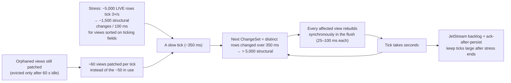

# Performance

What the POC set out to meet, how it was measured, what it achieved, and the incident that shaped the server. Every
number names its source: a checkpoint report under [`plans/checkpoints/`](plans/checkpoints) or
[testing.md](testing.md). How to run the load test yourself is in [user-guide.md](user-guide.md#load-test-and-grafana).

- [Requirements and targets](#requirements-and-targets)
- [Method](#method)
- [Current results: after the architecture split](#current-results-after-the-architecture-split)
- [Baseline: CP-4 final runs](#baseline-cp-4-final-runs)
- [JSON vs msgpack](#json-vs-msgpack)
- [Engine timings and memory](#engine-timings-and-memory)
- [Browser figures](#browser-figures)
- [A slower host: the 2026-10-09 reproduction](#a-slower-host-the-2026-10-09-reproduction)
- [The death spiral (CP-4)](#the-death-spiral-cp-4)
- [What the POC proved](#what-the-poc-proved)

## Requirements and targets

| Requirement | Scale |
|---|---|
| Rows | 1,000,000+ FX algo orders (6 months of history plus the current book) |
| Columns | 50, every one sortable and filterable; 14 groupable |
| Live prices | 20 currency pairs × 3 ticks/s; every LIVE order is repriced on its pair's tick |
| Order flow | ~100 updates/s and ~5 new orders/s (Medium); ~2,000 updates/s and ~50 new orders/s (Stress) |
| New rows | Arrive on top under the default sort; a scrolled-down view must not move; an "N new orders ↑" badge counts them |
| Clients | 50 concurrent blotters, each with its own view, on one server process |

| Target | Limit |
|---|---|
| `getRows` p95 (warm block fetch, client-measured) | < 50 ms |
| Sort / filter / group change on 1M rows (cold view build) | < 300 ms |
| Tick-to-screen p95, **end to end** (source event → client receives the delta), 50 clients, whole run incl. stress | < 150 ms |
| Server event-loop lag p99 | < 50 ms |
| Server RSS with 50 clients | < 2 GB |
| Scrolling | 60 fps |
| Order action (click → status on screen) | < 500 ms |

## Method

The load harness is [`talos`](../apps/talos) ([`CP-4.md`](plans/checkpoints/CP-4.md) §3):

- **Clients (seeded):** each picks a trader, a flat or grouped view (40% grouped), a sort and a filter (continuous
  thresholds, so most views are unique); scrolls 2 blocks/s with jitter; changes view about every 45 s; sends a Pause or
  Resume about every 10 s.
- **Special clients:** a slow consumer (stops reading at 20% of the run, requests 2,000-row blocks until cut off, then
  reconnects); a codec switcher (re-hello every 20 s, checks frame types); a controller that switches the load to stress
  from 120 s to 180 s.
- **Open loop, no coordinated omission:** each request stream has a fixed timeline; a slot already past due goes out at
  once, and latency = response time − **intended** send time, so a stalled server cannot hide its own delay. The
  generator's own send lag and event-loop lag are reported (p99 2 ms) so a slow generator can't pass for a slow server.
- **Tick-to-screen is end to end:** from the source event's timestamp (`delta.srcTs`) to the client receiving the delta.
  The last hop alone (`serverTs` → receipt) is reported separately.
- **Reports:** console tables plus `loadtest/results/<ts>-<codec>.json|.md`: latency percentiles, tick-to-screen and last
  hop, the startup burst (first view of all clients at once, reported separately and not gated), traffic per client,
  server CPU, RSS and lag scraped from `/metrics`, server-side histograms, and a PASS/FAIL table against the targets.

## Current results: after the architecture split

Source: [`PHASE-1.8.md`](plans/checkpoints/PHASE-1.8.md), 2026-10-13: the current architecture (`themis` stores orders,
`helios` publishes prices, the blotter reads NATS only), 50 clients × 300 s, json, one laptop (Docker VM: 8 CPUs, 6 GB),
after `scripts/loadtest-reset.sh`.

| Measure | CP-4 baseline | **Current** | Target | |
|---|---|---|---|---|
| getRows warm p95 (client) | 18.0 ms | **17.4 ms** | < 50 ms | ✅ |
| View change (cold) p95 | 37.7 ms | **33.8 ms** | < 300 ms | ✅ |
| Last hop p95 (`serverTs` → receipt) | 28 ms | **22 ms** | | |
| Tick-to-screen p95 (`srcTs` → receipt) | 62–65 ms | **85 ms** | < 150 ms | ✅ |
| Event-loop lag p99 | 23.1 ms | **18.3 ms** | < 50 ms | ✅ |
| Server CPU median | 22% | **20.4%** | | |
| Server RSS median (max) | 1,040 (1,099) MB | **985 (1,029) MB** | < 2,048 MB | ✅ |
| Command ack p95 | 66.5 ms | **87.2 ms** (p50 57, p99 108) | ≤ 150 ms | ✅ |

Tick-to-screen and the command ack grew, as planned: an order change now crosses `themis`'s group commit and the
`ORDER_STATE` bucket before the blotter sees it, and a command goes blotter → `themis` → venue → `themis` (stored and
published) → the blotter's store before the ack. Server side: `getRows` warm p95 0.9 ms, cold p95 28.0 ms, flush p50
1.4 ms / p99 37.3 ms. The slow consumer was closed with 1013 and recovered.

## Baseline: CP-4 final runs

The detailed runs on the pre-split architecture, kept as the reference the current figures are compared with.
Source: [`CP-4.md`](plans/checkpoints/CP-4.md) §12.1 (raw output §12.2–12.3). 50 clients × 300 s, 1M rows, Medium preset
with a 60 s stress window (120–180 s: ~2,000 order updates/s, up to ~5,000 LIVE rows), `FLUSH_MS=50`, one laptop (Apple
silicon, 6 GB Docker VM), each run after `scripts/loadtest-reset.sh`.

| Measure | JSON | msgpack | Target | |
|---|---|---|---|---|
| **Tick-to-screen** p50 / p95 / p99 | 38 / **65** / 80 ms | 38 / **62.5** / 76 ms | p95 < 150 ms | ✅ |
| Tick-to-screen p95, stress window | 75 ms | 72 ms | | |
| Last hop (`serverTs` → receipt) p50 / p95 | 4.5 / 28 ms | 4 / 22 ms | | |
| **getRows warm** p50 / p95 / p99 | 5.1 / **18.0** / 31.2 ms | 5.5 / **18.1** / 27.2 ms | p95 < 50 ms | ✅ |
| **View change (cold)** p50 / p95 / p99 | 16.8 / **37.7** / 52.0 ms | 16.8 / **38.2** / 46.7 ms | p95 < 300 ms | ✅ |
| getRows cold, server side p95 | 32.7 ms | 35.9 ms | | |
| Startup burst (50 cold views at once) p50 / p95 / max | 83 / 207 / 265 ms | 194 / 380 / 445 ms | not gated (< 2 s) | |
| **Event-loop lag** p99 / p99.9 / longest stall | **23.1** / 35 / 216 ms | **19.0** / 31.8 / 346 ms | p99 < 50 ms | ✅ |
| Server CPU median (max), % of one core | 22% (112%) | 24% (114%) | | |
| **Server RSS** median (max) | 1,040 (1,099) MB | 1,019 (1,065) MB | max < 2,048 MB | ✅ |
| Command ack p50 / p95 | 37.7 / 66.5 ms | 37.8 / 66.3 ms | | |
| Flush p50 / p99 (server histogram) | 1.13 / 44.2 ms | 1.15 / 36.0 ms | | |
| Bytes in per client | 147 KB/s | 131 KB/s (−11%) | | |
| Messages in per client | 9.3 /s | 9.2 /s | | |
| Requests timed out | 0 | 0 | | |

A **600 s soak** (both codecs, 240 s of stress) ran without a stall: event-loop p99 26.1 ms, RSS max 1,114 MB
([`CP-4.md`](plans/checkpoints/CP-4.md) §5.3). Of the tick-to-screen time, the last hop is only p95 22–28 ms; the rest is
waiting for the 50 ms flush and NATS delivery.

## JSON vs msgpack

| | JSON | msgpack |
|---|---|---|
| Bytes in per client | 147 KB/s (`rows` 111, `delta` 36) | 131 KB/s (`rows` 97, `delta` 34) |
| Tick-to-screen p95 | 65 ms | 62.5 ms |
| getRows warm p95 | 18.0 ms | 18.1 ms |
| Server CPU median | 22% | 24% |
| Startup burst max | 265 ms | 445 ms |

msgpack carries about 11% fewer bytes (13% on `rows`, 5% on `delta`), costs slightly more server CPU, and latency is the
same within noise. JSON is the default for debuggability; msgpack suits constrained links.

## Engine timings and memory

**Cold builds at 1M rows** ([`CP-2.md`](plans/checkpoints/CP-2.md), `vitest bench`, Apple silicon, means;
`pnpm --filter @apeiron/antikythera bench` reruns them):

| Operation | Mean | Target |
|---|---|---|
| Default view (createdAt desc) | 24.5 ms | < 300 ms |
| Selective filter + sort (46,571 rows match) | 11.7 ms | < 300 ms |
| Three-column sort over all rows | 29.6 ms | < 300 ms |
| One-level group, four aggregates | 11.1 ms | < 300 ms |
| Two-level group (expand EURUSD) | 13.9 ms | |
| Warm block fetch, 100 rows | 0.109 ms (p99 0.27 ms) | < 5 ms |

**Store memory at 1M rows** (CP-2): typed arrays 257.5 MB used (386 MB reserved for 1.5M rows of headroom), string heap
~165 MB, heap after GC 223–226 MB; a flat 1M-row view costs about 8 MB. Loading 1.7M rows from `ORDER_STATE` in the
compose stack takes 11.8 s end to end (sort 0.5 s, ranks 1.2 s), peak RSS 2.0 GB. The blotter container is capped at
`mem_limit: 3g`.

**Order actions:** click to status on screen p50 58 ms / p95 89 ms (phase 6,
[`PHASE-6.md`](plans/checkpoints/PHASE-6.md)); under 50 clients (CP-4 final) command ack p50 38 ms / p95 66–67 ms.

## Browser figures

Source: [`CP-3-review.md`](plans/checkpoints/CP-3-review.md) (Chrome DevTools, 1600×900, DPR 2, 120 Hz display) and
[`CP-3.md`](plans/checkpoints/CP-3.md).

| Scenario | Result |
|---|---|
| Default view, Medium | 120 FPS |
| Fast scripted scroll to ~row 300,000 | 103 FPS average, p95 frame 10.1 ms, one 142 ms frame (a block fetch), no long tasks |
| Stress preset (~3,980 LIVE, ~51 new orders/s) | 112–114 FPS; server CPU 6–9%, RSS 844 MB |
| Stress, msgpack, top of grid (950–1,300 rows updated/s) | 115–120 FPS |
| Stress with programmatic scrolling | 81–111 FPS |
| JS heap | 27 MB Medium, 48 MB after Stress |
| Anchoring | at row 312,710 for 15 s, the same order stayed at the top while 75 orders arrived above it; badge 20 → 95 |

## A slower host: the 2026-10-09 reproduction

Raw output and environment: [`PHASE-10.md`](plans/checkpoints/PHASE-10.md). A 4-vCPU KVM cloud container (Intel Xeon @
2.80 GHz, no GPU) running the stack, the load generator and the browser: **3.9–7× slower** per engine operation than the
laptop (cold default view 116.6 ms vs 24.5; warm block fetch 0.68 vs 0.109 ms; store load 45–51 s vs 9.5 s).

| Measure (50 clients × 300 s) | JSON | msgpack | Target | |
|---|---|---|---|---|
| Tick-to-screen p50 / p95 / p99 | 56 / 420 / 643 ms | 57 / 401.5 / 626 ms | p95 < 150 ms | ❌ |
| Tick-to-screen p95: baseline / stress / after | 103 / 692 / 235 ms | 103 / 672 / 220.5 ms | | |
| getRows warm p50 / p95 | 9.1 / 260.4 ms | 9.9 / 257.5 ms | p95 < 50 ms | ❌ |
| View change (cold) p95 | 352.5 ms | 226.8 ms | p95 < 300 ms | ❌ / ✅ |
| Event-loop lag p99 / p99.9 / longest stall | 193.3 / 441.7 / 1,362.6 ms | | p99 < 50 ms | ❌ |
| Server CPU median (max) | 65.3% (215.4%) of one core | | | |
| Server RSS median (max) | 1,301 (1,503) MB | | < 2,048 MB | ✅ |
| Requests timed out | 0 | 0 | | |

On a host 4–7× slower per operation the same code misses four of five targets, but degrades gracefully: no timeouts, no
wedge after the stress window, the slow consumer was cut off and reconnected, and the baseline tick-to-screen p95
(103 ms) is within target. Capacity is CPU-bound on one thread, which is what the `worker_threads` next step in
[decisions.md](decisions.md#next-steps) addresses. The laptop figures above remain the reference. No run on the AWS
Graviton box (`t4g.xlarge`) has been made yet.

## The death spiral (CP-4)

The most important lesson of the POC. Sources: [`CP-4-diagnosis.md`](plans/checkpoints/CP-4-diagnosis.md),
[`CP-4.md`](plans/checkpoints/CP-4.md) §4, [`CP-4-review.md`](plans/checkpoints/CP-4-review.md).

**Symptom.** The first 50-client × 300 s run: stress started at 120 s; by ~140 s event-loop stalls of 2.7 s then 13 s;
from 180 s every request timed out (15 s client timeout), **13,272 timeouts**, and the server stayed wedged for about 2
minutes *after* stress ended. Average CPU was only ~25%.

**Profiling.** The blotter under `node --cpu-prof`, driven by talos (50 clients, 100 s, stress from 40 s). Stress-window
busy time: `flush → View.applyChanges → patch/applyLeaf` **60% inclusive**; the sort comparator `rank` 15% self;
`getRows` 13%; encoding 5%. Client-measured cold `getRows` p95 was 599 ms against 44 ms server-measured: requests were
queueing behind flush work. Steady state was fine; this was a **feedback loop, not overload**.

**Fix** (R1–R3, R5): untracked views go stale; no synchronous rebuild in a flush (deferred, throttled, one per event-loop
turn); a 40 ms budget, most-watched views first, with skipped ticks in a **shared** log merged once per `appliedSeq`. The
first R3 version copied ticks into every deferred view; its own profile of a second stall showed the copying was the next
spiral, and the shared log replaced it. The resulting loop is described in
[architecture.md](architecture.md#the-budgeted-flush-loop).

**A second, environmental cause.** With the flush fixed, a 600 s soak still stalled (84 s, 182 s). The CPU profile showed
nothing unusual; `/proc/pressure/memory` showed memory stalls 60–76% of the time and swap full. MongoDB's WiredTiger cache
defaults to half the VM's RAM; on a shared 6 GB VM it pushed the VM into swap and every container stalled together. Fix:
`--wiredTigerCacheSizeGB 1` (`MONGO_CACHE_GB`, see [hosting.md](hosting.md#memory-mongo_cache_gb)).

**Before and after** (50 clients, 300 s, json; [`CP-4.md`](plans/checkpoints/CP-4.md) §4.4, "after" at `FLUSH_MS=100`):

| | Before (`c4845aa`) | After | Target |
|---|---|---|---|
| getRows warm p95 | 15,002 ms (timeouts) | 17.4 ms | < 50 ms |
| View change (cold) p95 | 15,002 ms | 110 ms | < 300 ms |
| Event-loop lag p99 | 2,179 ms (worst 1 s window) | 17.8 ms | < 50 ms |
| Flush p99 | 192 ms | 44 ms | |
| Requests timed out | 13,272 | 0 | |
| Server RSS max | 1,171 MB | 1,035 MB | < 2,048 MB |

**Then the latency ruling.** With the server healthy, the review asked what "tick-to-screen" means. The last hop was
21–25 ms p95, but the oldest event waited 151–193 ms p95 before its flush ran. It was ruled **end to end** (source event to
client); meeting that needed `FLUSH_MS=50` (event age at flush p95 192 → 78 ms, for ~4 points of CPU) and `delta.srcTs` to
measure it honestly. Final: p95 62.5–65 ms.

**Lessons.**

- Measure latency from the *intended* send time; a closed-loop generator would have hidden the collapse.
- Bound work per tick by time, not by count; work that can't fit must cost nothing while it waits.
- Don't maintain state nobody reads.
- Profile the fix too (the per-view carry copies were the next spiral).
- Check the environment (memory pressure) before blaming the code.
- Agree what a latency target measures before claiming it.

## What the POC proved

- **The grid.** One Node process holds 1M+ orders × 50 columns in memory (about 1 GB RSS) and serves 50 concurrent
  blotters, each with its own sort, filter or grouping, while live updates keep coming.
- **Latency** (current architecture). Warm block fetch ~17 ms p95; view change ~34 ms p95; end-to-end tick-to-screen
  ~85 ms p95; an order action round trip ~87 ms p95, all well inside their targets.
- **Load.** Under stress (about 5,000 LIVE orders ticking 3×/s, ~15k row updates/s), event-loop p99 stays under 25 ms and
  median CPU is about 22–24% of one core.
- **Correctness under load.** Incremental views are proven identical to full rebuilds (property tests and live
  cross-checks); slow consumers are conflated, then disconnected (`SLOW_CONSUMER`) without hurting anyone else; the
  resilience suite proves the grid is complete and current after network faults ([testing.md](testing.md)).
- **Limits found** are listed in [decisions.md](decisions.md#known-limitations).
