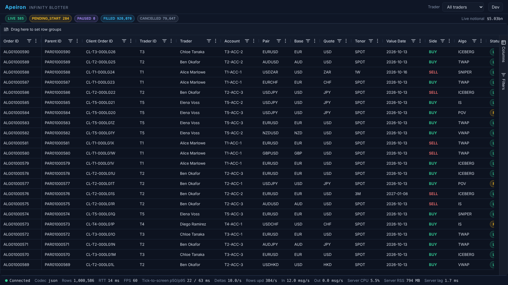
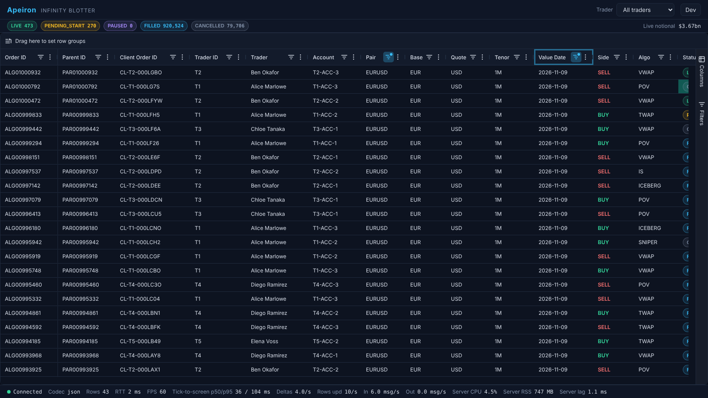
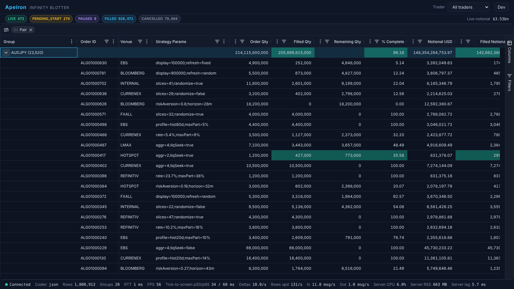
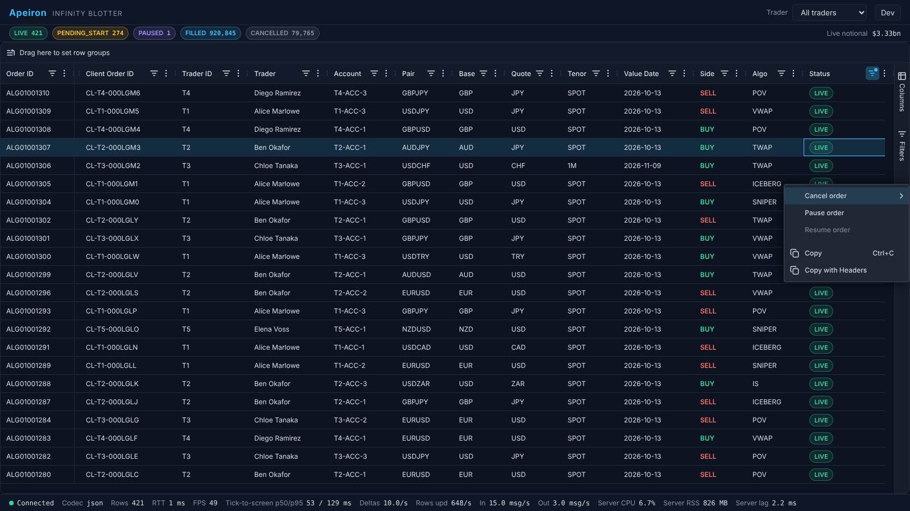
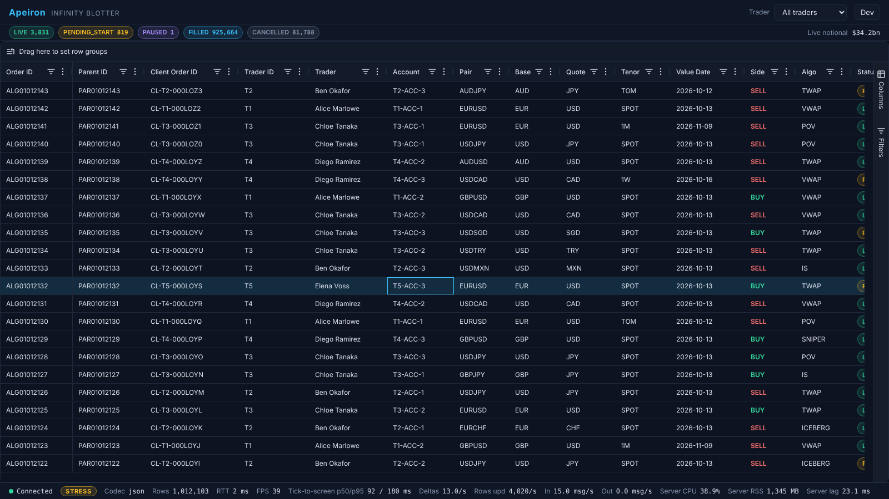

# Apeiron: User Guide

How to run the Infinity Blotter locally, use it, and fix it when something goes wrong. How it works inside is in
[architecture.md](architecture.md); the compose profiles, ports and variables in [hosting.md](hosting.md#local); every test
layer in [testing.md](testing.md); running it on AWS in [runbooks/aws-remote-box.md](../runbooks/aws-remote-box.md).

- [Running it](#running-it)
- [Using the blotter](#using-the-blotter)
- [Load test and Grafana](#load-test-and-grafana)
- [Troubleshooting](#troubleshooting)

## Running it

### Prerequisites

| Need | Version / size | Why |
|---|---|---|
| Docker with Compose v2 | Docker Desktop, or Docker Engine 29+ | every service runs in a container |
| Memory for the Docker VM | **at least 6 GB** | the blotter uses ~1 GB under load (3 GB cap), Mongo's cache is capped at 1 GB, plus NATS, the other services, Prometheus, Grafana |
| Node.js | **24** (`engines: >=24`) | the tests, the load harness and local builds |
| pnpm | 10 (`packageManager: pnpm@10.33.0`; `corepack enable` installs it) | the monorepo |
| Chromium for Playwright | `pnpm --filter @apeiron/e2e exec playwright install chromium` (once) | E2E and resilience tests |

### Clone and start

```bash
git clone https://github.com/iAppGeek/apeiron.git && cd apeiron
pnpm install
pnpm lint && pnpm typecheck && pnpm test && pnpm build          # optional: check the build (about 1–2 minutes)

cp .env.example .env                                           # optional local overrides, never committed
docker compose --profile core up -d --build mongo nats         # database and bus first
docker compose --profile core --profile seed run --rm gaia     # seed 1,000,000 orders (~1–3 min; a second run is a no-op)
docker compose --profile core --profile monitoring up -d --build   # every service, plus Prometheus and Grafana
curl -s localhost:4000/health                                  # wait for "status":"ok" (loading 1M rows takes ~10–20 s)
```

Open <http://localhost:8080> and pick who you are (see [Users](#users)). Seed **before** starting the services:
`themis` builds the `ORDER_STATE` bucket the blotter loads from when it starts. If you seed into a running stack, restart
`themis` and then `antikythera` (`docker compose --profile core restart themis antikythera`). The ports of every service
are listed in [hosting.md](hosting.md#ports).

For hot reload while working on the web app: `pnpm --filter @apeiron/pharos dev` (<http://localhost:5173>; Vite proxies
`/ws` to the server on 4000).

### Seeding and reset

Test runs add orders (the table grows to ~1.3–1.5M rows after the resilience suite) and a stress run leaves thousands of
LIVE orders draining. Before a demo, a benchmark or screenshots, put the stack back to a known state:

```bash
scripts/loadtest-reset.sh
```

It stops the blotter, `themis`, `helios`, `hermes` and NATS, empties JetStream, re-seeds 1M rows with `SEED_RESET=true`
(a fresh 6-month window ending today), starts `core` + `monitoring` on the Medium preset and waits for `/health`
(~45 s on a laptop). The seed variables (`SEED_ROWS`, `SEED`, `SEED_NOW`, `SEED_RESET`) are described in
[data-model.md](data-model.md#the-seeded-dataset).

### Stopping

```bash
docker compose --profile core --profile monitoring down        # keeps the data volumes
docker compose --profile core --profile monitoring down -v     # also deletes Mongo, NATS and Prometheus data
```

## Using the blotter



### Layout

- **Header:** the *Apeiron / Infinity Blotter* brand, the **trader selector**, and the **Dev** menu.
- **Summary strip** (under the header): chips for LIVE, PENDING_START, PAUSED, FILLED and CANCELLED counts, and the live
  notional, for the selected trader (and filter).
- **Grid:** 1M+ orders × 50 columns. The **row group panel** sits above it ("Drag here to set row groups"); a side bar
  on the right has the **Columns** and **Filters** tool panels.
- **Status bar** (bottom): see [below](#status-bar).

### Users

On first load the blotter asks who is looking: one of the five traders (`TRADER1`–`TRADER5`, each seeing only their own
trader) or `SUPERVISOR` (everyone). There are no passwords; the users are listed in `infra/config/entitlements.json`.
Switch user from the header select; `?user=TRADER2` in the URL picks one directly, and each browser tab keeps its own.

### Traders

Pick a trader or **All** from the selector; it offers only the traders your user may see. The grid, the summary chips and
the row count re-scope to that trader; a trader switch starts at the top of the grid.

### Live data

- LIVE rows tick as their pair's price moves (3 ticks/s per pair). Changed cells flash; price cells turn **green (up)** or
  **red (down)** for 600 ms.
- New orders arrive **on top** under the default sort (newest first, `createdAt` descending).
- Scrolled down, the rows you are looking at **stay put**; a **"N new orders ↑"** badge counts what arrived above.
  Click it to jump to the top (it clears); scrolling back to the top also clears it.

### Sorting

Click a column header to cycle ascending → descending → unsorted; shift-click to add more sort columns. With no sort the
grid is newest first. Sorting 1M rows takes tens of milliseconds on the server.

### Filters

Open a column's menu (☰ in the header) or the **Filters** tool panel:

| Filter | Columns | Notes |
|---|---|---|
| **Set** | enums (status, pair, side, algo type, venue, trader…) | tick values; the list comes from the server for the current trader |
| **Number** | quantities, prices, bps, P&L… | equals, not equal, <, ≤, >, ≥, **in range (inclusive)**, blank, not blank |
| **Date** | createdAt, startTime, endTime, valueDate… | whole UTC days: "equals 2026-09-15" means that whole day; in range includes both days |
| **Text** | orderId, clientOrderId, parentOrderId, strategyParams | contains, starts with, equals… (case-insensitive) |

Filters on several columns combine with AND; a column filter can hold two conditions with AND or OR. The row count in the
status bar updates at once.



### Grouping

Drag a groupable column header (pair, status, trader, account, side, algo type, venue, tenor, value date…) into the row
group panel, or use the column menu's *Group by*. Drag a second column for two levels. Group rows show the child count and
aggregates: sums for quantities, notional and P&L; notional-weighted averages for slippage, performance vs VWAP and
% complete. Expand a group to see its orders; the aggregates keep ticking. Remove a group column by dragging it out of the
panel (or its ✕).



### Order actions

Right-click an order (or press the ContextMenu key) to get **Cancel**, **Pause**, **Resume** and **Amend order…**,
enabled by the order's status:

| Status | Cancel | Pause | Resume | Amend |
|---|---|---|---|---|
| LIVE | ✓ | ✓ | | ✓ |
| PAUSED | ✓ | | ✓ | ✓ |
| PENDING_START | ✓ | | | ✓ |
| FILLED, CANCELLED | | | | |

Cancel asks for confirmation in a submenu. **Amend order…** opens a dialog to change the limit price, quantity, end time
or urgency; it warns before sending if the order service would refuse the change. The row shows a pending marker until
the server confirms; the change shows in well under a second. If the order changed state meanwhile (it filled, or
someone else cancelled it), an error toast explains why. Group rows have no order actions; Copy and Copy with Headers are
always there.



### Dev menu

The **Dev** button in the header opens:

- **Wire codec:** JSON or MessagePack. Switching re-sends `hello`, reloads the grid in place (your scroll position is kept),
  and the status bar's *Codec* changes. Works both ways.
- **Load preset:** Medium or **Stress** (the rates are in
  [architecture.md](architecture.md#prices-and-the-venue-helios-hermes)). The active preset is shown, and a **STRESS** pill appears in the status bar while stress is
  on. The preset applies to the whole stack (every connected user sees it). After going back to Medium, LIVE drains back
  to ~500 over a minute or two.

### Status bar

| Item | Meaning |
|---|---|
| ● Connected / Reconnecting (#n) | the WebSocket state; the client reconnects on its own and keeps your place |
| STRESS | the stress preset is on |
| Codec | `json` or `msgpack` |
| Rows (and Groups when grouped) | total orders for the view, from the server; number of groups at the top level |
| RTT | WebSocket round trip (ping/pong) |
| FPS | the page's frame rate |
| Tick-to-screen p50/p95 | from the source event to the delta reaching this page, rolling 10 s, clock-offset corrected |
| Deltas, Rows upd | live delta messages and rows updated per second |
| In / Out | messages per second each way |
| Server CPU / RSS / lag | the server's CPU (% of one core), memory, and event-loop lag |



## Load test and Grafana

```bash
scripts/loadtest-reset.sh                                            # always start from a known state
pnpm --filter @apeiron/talos start -- --clients 50 --duration 300 --codec both
docker compose --profile core --profile loadtest run --rm talos      # the same, from a container
```

Flags: `--clients`, `--duration` (s), `--codec json|msgpack|both`, `--no-slow`, `--no-switcher`, `--no-special`. The
default run includes a slow consumer, a codec switcher and a 60 s stress window centred in the run (120–180 s of a 300 s
run; `--stress-at`, `--stress-for`). Results go to the
console and to `loadtest/results/<timestamp>-<codec>.json` and `.md`, with a PASS/FAIL table against the targets.

Watch it live in Grafana: <http://localhost:3001>, dashboard **"Apeiron: Blotter Server"** (panels listed in
[architecture.md](architecture.md#observability); red lines mark the targets). The method and the reference results
are in [performance.md](performance.md). The other test tiers (unit to resilience) are in [testing.md](testing.md).

## Troubleshooting

| Symptom | Likely cause | Fix |
|---|---|---|
| Everything stalls for tens of seconds; `docker stats` shows memory near the VM limit | Docker VM too small or swapping (MongoDB's cache defaults to half the VM) | Give Docker ≥ 6 GB; keep `MONGO_CACHE_GB=1` (raise it only on a big host, e.g. 4 on 16 GB); stop other stacks |
| `/health` returns 503 for a while | the server is still loading; its `stage` says where (`snapshot`, `catchup`, `prices`, `warmup`) | wait (~10–20 s for 1M rows); `docker compose logs -f antikythera` |
| `/health` stays at stage `snapshot` | `ORDER_STATE` is not ready: `themis` is down or still rebuilding it | `docker compose --profile core ps themis`; `docker compose logs themis` |
| Grid empty, row count 0 | the services started before seeding | seed, then `docker compose --profile core restart themis antikythera` |
| Prices frozen, orders still change | `helios` is down | `docker compose --profile core start helios` |
| Row count far above 1M, many LIVE orders, sluggish start | earlier tests or stress runs grew the data or left a JetStream backlog | `scripts/loadtest-reset.sh` |
| Grid shows "Reconnecting" and never recovers | server down or restarting | `docker compose --profile core ps`; `docker compose logs antikythera`; restart it |
| No ticks, LIVE count stuck | hermes stopped (e.g. a killed resilience run) | `docker compose --profile core start hermes`; `curl -s -X POST localhost:8474/reset` if toxics remain |
| STRESS pill stays on | the preset is global | Dev → Load preset → Medium (LIVE drains over a minute or two) |
| `port is already allocated` on `compose up` | another process or stack holds one of the [ports](hosting.md#ports) | stop it (`lsof -i :8080`), or change the host port in a local compose override |
| `pnpm` refuses to run, or engine warnings | Node older than 24 | install Node 24 and `corepack enable` |
| Playwright says the browser is missing | Chromium not installed | `pnpm --filter @apeiron/e2e exec playwright install chromium` |
| Console shows a boxed AG Grid licence message | expected: Enterprise is used without a licence key (watermark accepted) | nothing to do |

Diagnostics: `curl -s localhost:4000/health`, `curl -s localhost:4000/debug/lag` (flush and lag figures),
`curl -s localhost:4200/debug` (`themis`: open orders, last commit), `curl -s localhost:4000/metrics | grep apeiron_`,
and `pnpm --filter @apeiron/antikythera exec tsx src/testing/live-report.ts --scenario default --seconds 15` (also
`grouped`, `stress`, `persistence`, `consistency`).

Known limitations (what the blotter does not do, or does imperfectly) are listed in
[decisions.md](decisions.md#known-limitations).
